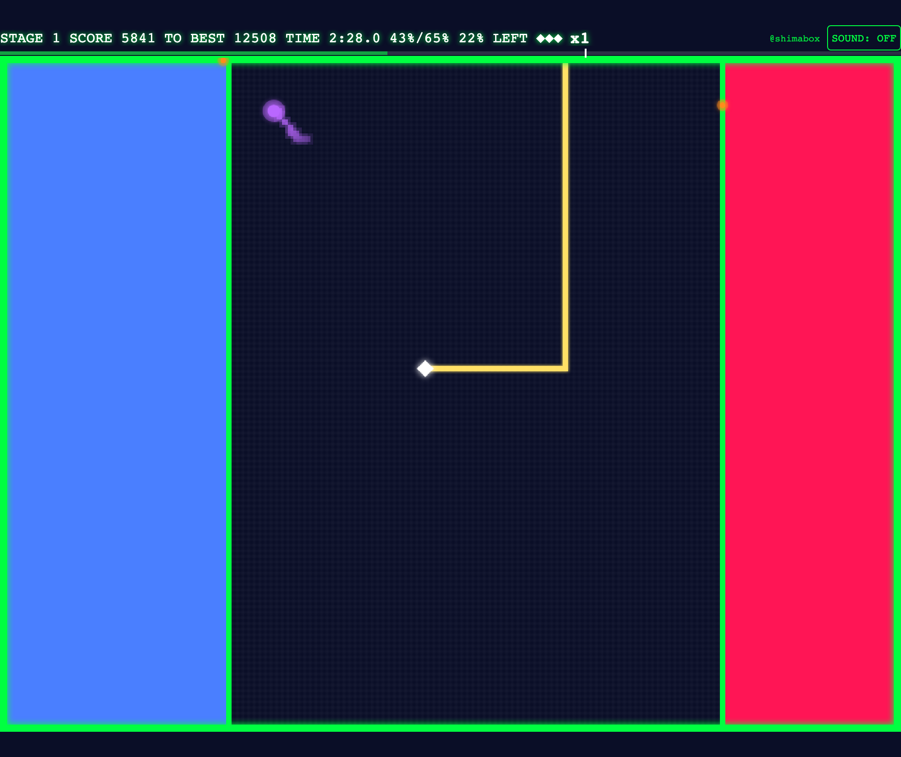

# QIXXX（キックス）

[](https://qixxx.orukubami.sh/)
[](https://x.com/shimabox)

線を引いて陣地を切り取り、占有率が目標に届けばステージクリア。ネオン風の陣取りアクションゲームです。  
1981 年のアーケードゲーム QIX へのオマージュとして、メカニクスは原作準拠・名称やビジュアルはオリジナルで作られています。



## 見どころ

- **低速ラインは得点 2 倍。** ゆっくり引くぶん危ないですが、取った陣地の得点が 2 倍になります。一度に陣地を大きく取ると、さらに点が増えます。
- **分断で一発クリア。** ラインでウィスプ同士を切り離せば、占有率に関係なくその場でステージクリアです。
- **ステージごとに違う顔。** 15 のステージそれぞれに名前と性格があり、NORMAL のステージ 6 からは陣地を取るほどウィスプが速くなります。
- **取った瞬間の手応え。** 確定の一瞬の止め、線の光と火花、効果音と BGM が、切り取った気持ちよさを返します。
- **TOP 10 を競う。** NORMAL のスコアでオンラインランキングの TOP 10 を競えます。上位のプレイはリプレイで見られ、X へのシェアはスコア入りのカード画像付きです。
- **すぐ遊べる。** インストール不要で、スマホでも遊べます。ウィスプが遅くライフの多い EASY もあります。

**➡️ 詳しいルールと遊び方: [遊び方ガイド](docs/how-to-play.md)**


## 遊ぶ

**🎮 ブラウザですぐ遊べます: https://qixxx.orukubami.sh/**

ローカルで動かす場合:

```bash
npm install
npm run dev
```

表示された URL（例: `http://localhost:5173/`）を開き、キーを押すか盤面をタップするとゲームが始まります。
音は初回 `SOUND: OFF` で、画面右上のボタンで `SOUND: ON` に切り替えると、効果音とプレイ中の BGM が鳴ります。

### 基本操作

| 操作 | キー |
|---|---|
| 移動 | 矢印キー / `H` `J` `K` `L`（Vim 風） |
| 高速ライン | `X` / `Space` を押しながら移動 |
| 低速ライン（得点 2 倍） | `Shift` / `Z` を押しながら移動 |
| 一時停止 / 再開 | `P` / `Esc` |

スマホでは仮想十字キーと `FAST` / `SLOW` ボタンで操作し、`PAUSE` ボタンで一時停止します。

文字キーが効かないときは、ブラウザ拡張か日本語入力（IME）がキーを横取りしている可能性があります（対処は[遊び方ガイドの「一時停止」の節の注意](docs/how-to-play.md#一時停止)）。

## 開発

- TypeScript (strict) + Canvas 2D — フレームワーク・ゲームエンジン不使用
- Vite（開発・ビルド） / Vitest（ユニットテスト） / Playwright（E2E スモーク）
- 効果音と BGM は Web Audio API による実行時生成（音源アセットなし）
- Cloudflare Pages + Pages Functions + D1・Workers KV（ホスティング、ランキング、X シェアのカード）

```bash
npm run dev        # 開発サーバ起動
npm run build      # プロダクションビルド（dist/）
npm test           # ユニットテスト（Vitest）
npm run e2e        # E2E スモークテスト（Playwright）
npm run lint       # ESLint
npm run typecheck  # tsc --noEmit
npm run docs:shots # 文書用スクリーンショット（docs/images/）の撮り直し
```

デバッグパネル、画面写真の撮り直し、ディレクトリ構成は [開発ガイド](docs/development.md) にあります。

## ライセンス

[MIT](LICENSE)

演出の文字に使う書体 Orbitron（`public/fonts/Orbitron-wght.ttf`）を同梱しています。この書体のライセンスは SIL Open Font License 1.1 で、全文は [`public/fonts/Orbitron-OFL.txt`](public/fonts/Orbitron-OFL.txt) にあります。
