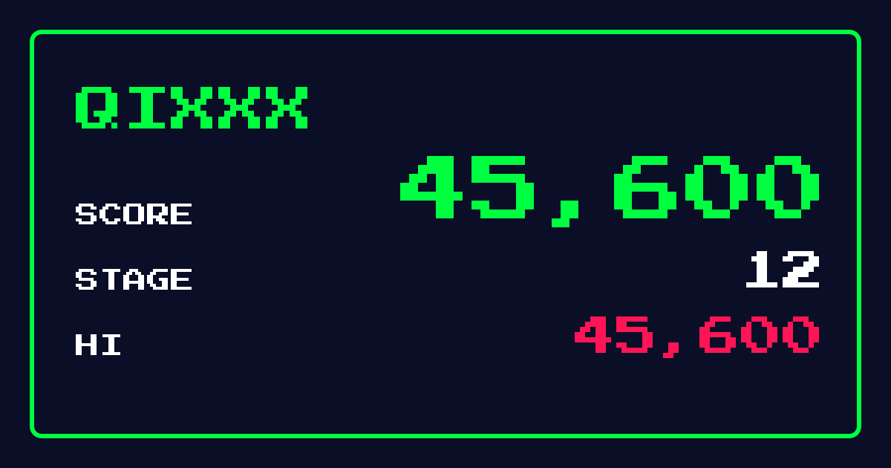
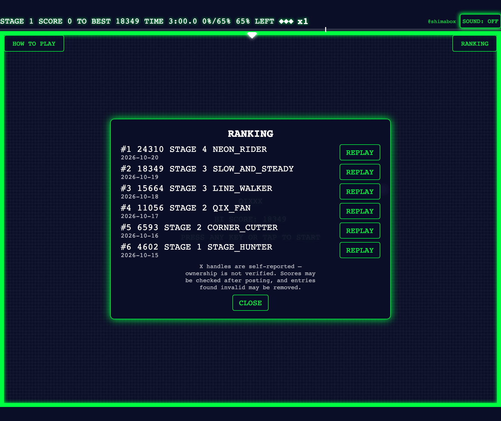
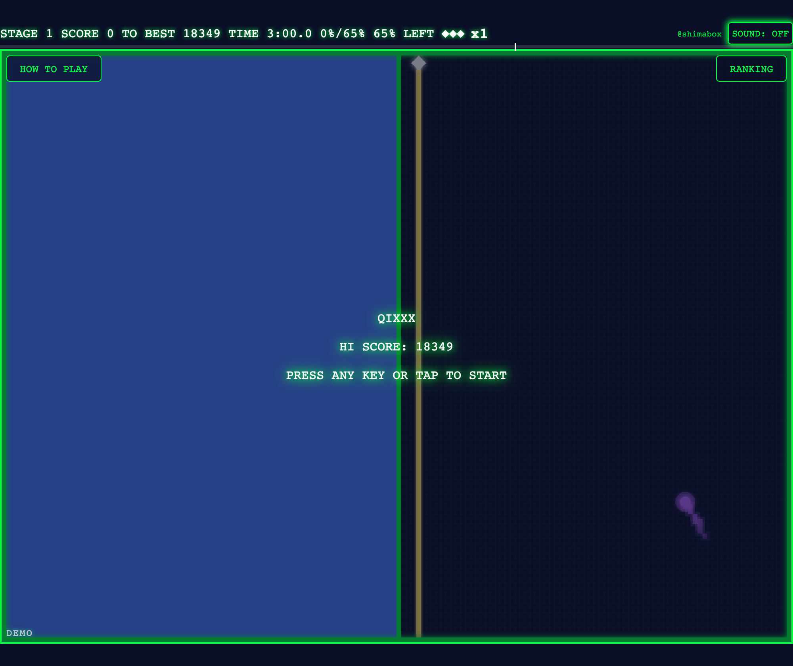
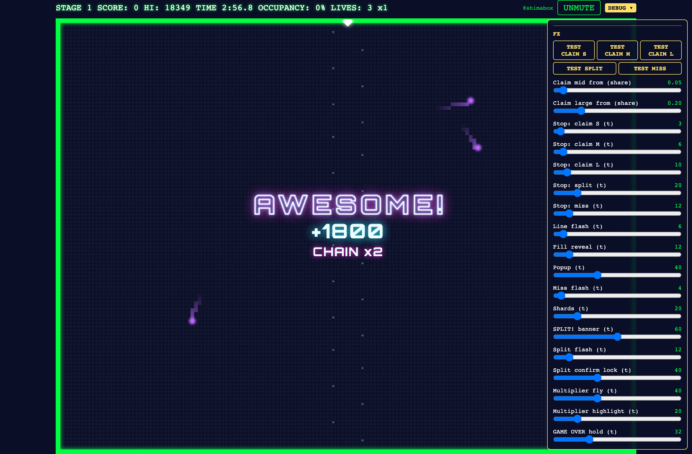
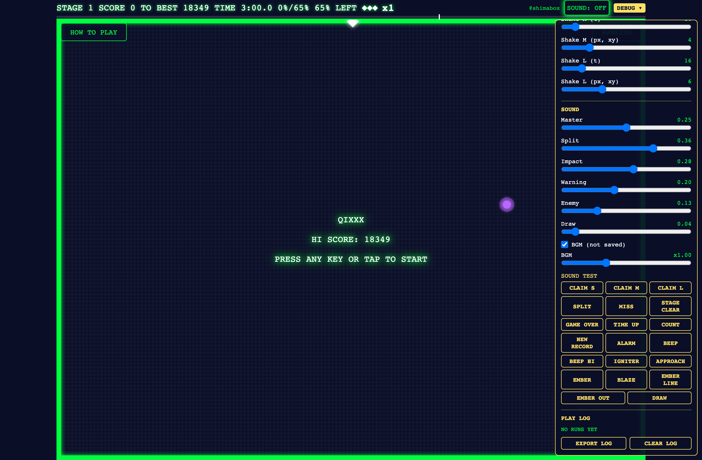

# QIXXX（キックス）

[](https://qixxx.orukubami.sh/)
[](https://x.com/shimabox)

線を引いて陣地を切り取る、ネオン風の陣取りアクションゲーム。  
1981 年のアーケードゲーム QIX へのオマージュとして、メカニクスは原作準拠・名称やビジュアルはオリジナルで作られています。


敵に触れないようにフィールドへラインを引き、**占有率が目標値に達したらステージクリア**。
目標値はステージ 1 が **65%**、ステージが進むごとに少しずつ上がり、ステージ 10 で最大の **90%** になります。敵（ウィスプ）もステージごとに増え、ステージ 10 で最大の **10 匹**に到達します（速度・出現間隔なども同時に最大まで上昇し、11 面以降はその最大値のまま据え置きです）。
敵が 2 匹以上いるステージでは、ラインで敵同士を**分断**すると占有率に関係なく即クリア（一発逆転の大技）。
デスクトップ（キーボード）とスマホ（タッチ）の両方で遊べます。
日本語表示にも対応しています（ブラウザの言語が日本語なら、案内やお知らせの文が日本語になります）。

ゲームオーバー時には、そのプレイのスコアを **X（旧 Twitter）にシェア**できます。スコア入りのカード画像付きで投稿されます。



スコアが **TOP 10** に入る見込みのときは、ゲームオーバー画面から名前または X ハンドルを添えて **オンラインランキングに投稿**できます。タイトル画面の **RANKING** ボタンで上位 10 件を確認でき、各エントリの **REPLAY** でそのプレイを最初から再生して見られます。



**➡️ 詳しいルールと遊び方: [遊び方ガイド](docs/how-to-play.md)**

## 遊ぶ

**🎮 ブラウザですぐ遊べます: https://qixxx.orukubami.sh/**

ローカルで動かす場合:

```bash
npm install
npm run dev
```

表示された URL（例: `http://localhost:5173/`）をブラウザで開き、何かキーを押す（タップする）とスタートします。タイトル画面では、右上の **RANKING** ボタンからランキングを、左上の **HOW TO PLAY** ボタンから遊び方のまとめを開けます。



> 🔊 **音と BGM があります（初回は `SOUND: OFF`）。** 画面右上のボタンを押して **`SOUND: ON`** にすると、ライン引き・エリア確定・ミスなどに合わせて効果音が鳴り、プレイ中は BGM も流れます（ステージごとに曲が変わります）。残り時間が少なくなると警告音でも知らせます（残り 30 秒と 15 秒で 1 回ずつ、残り 10 秒からは 1 秒ごと）。設定は保存され、次回以降も引き継がれます。

### 基本操作（デスクトップ）

| 操作 | キー |
|---|---|
| 移動 | 矢印キー / `H` `J` `K` `L`（Vim 風） |
| 高速ライン | `X` / `Space` を押しながら移動 |
| 低速ライン（2 倍得点） | `Shift` / `Z` を押しながら移動 |
| 一時停止 / 再開 | `P` / `Esc` |

スマホでは画面下部の仮想十字キーと `FAST` / `SLOW` ボタンで操作し、`PAUSE` ボタンで一時停止します。

> ⚠️ **キーが効かないときは:** Vimium などのブラウザ拡張が `H` `J` `K` `L` `X` `Z` といった文字キーを横取りしている可能性があります（矢印キーと Space だけ効くのが典型的な症状）。**シークレットウィンドウで開く**か、拡張の除外サイトにこのゲームの URL を追加してください。日本語入力（IME）が ON の場合も同様なので、英数モードでプレイしてください。

## 技術スタック

- TypeScript (strict) + Canvas 2D — フレームワーク・ゲームエンジン不使用
- Vite（開発・ビルド） / Vitest（ユニットテスト） / Playwright（E2E スモーク）
- 効果音と BGM は Web Audio API による実行時生成（音源アセットなし）
- ホスティングは Cloudflare Pages（qixxx.orukubami.sh）
- X シェアのスコアカードは Cloudflare Pages Functions + Workers KV + workers-og（Satori）でエッジ動的生成
- スコアランキング（投稿・TOP 10・リプレイ）は Cloudflare Pages Functions + **Cloudflare D1** に保存。リプレイは投稿時の入力記録をクライアント側で再生

コアロジック（`src/core/`）は DOM・Canvas 非依存の純 TypeScript で、ユニットテストで網羅しています。

## 開発コマンド

```bash
npm run dev        # 開発サーバ起動
npm run build      # プロダクションビルド（dist/）
npm test           # ユニットテスト（Vitest）
npm run e2e        # E2E スモークテスト（Playwright）
npm run lint       # ESLint
npm run typecheck  # tsc --noEmit
npm run docs:shots # 文書用スクリーンショット（docs/images/）の撮り直し
```

`docs/images/` の画面写真（`readme-share-card.png` を除く）は `npm run docs:shots` で撮り直せます。ビルドしてローカルで配信し、偽装した時計と作りもののランキングで毎回同じ画面を撮ります（`npm run docs:shots -- hud wisp` のように名前を渡すとその画像だけ）。今の画像は macOS の Playwright Chromium で撮っています。画面が変わったら流し直してください。

### デバッグパネル（開発用）

開発サーバで URL に `?debug` を付けると、敵の数・速度・出現間隔・要求占有率などをスライダーで即時調整できるパネルが出ます（プロダクションビルドには含まれません）。下の `FX` の区画では、確定・分断・ミスの演出（止め・揺れ・表示の長さ・文字の裂け・火花・連続確定・スコアの数え上げなど）の数値を調整し、`TEST CLAIM S / M / L`・`TEST SPLIT`・`TEST MISS` で試し打ちできます。`TEST CLAIM` を続けて押すと、連続確定の表示と音の上がり方も確かめられます。この区画はプレイの設定を変えないので、使ってもハイスコアの保存やランキングの投稿に影響しません。`EXPORT` でチューニング結果を JSON として書き出せます。`RESET HINTS` を押すと、遊びの中の案内の既読を消して、もう一度最初から出せます。

その下の `SOUND` の区画では、効果音の種類ごとの音量、BGM の入切（保存されません）と大きさを調整でき、`SOUND TEST` のボタンで音を 1 つずつ試聴できます。`PLAY LOG` の区画には、この端末で終えた最新 50 回のプレイの集計（終わったステージ、ミスの内訳、スコアなど）が出ます。`EXPORT LOG` で記録を JSON として書き出し、`CLEAR LOG` で消せます。記録は端末の中だけに保存され、外へは送りません。





## ディレクトリ構成

```
src/
├── core/     # ゲームロジック（DOM 非依存・テスト対象の中心）
├── render/   # Canvas 描画（盤面・演出・案内の印）
├── input/    # キーボード・タッチ入力
├── audio/    # Web Audio の効果音と BGM
├── fx/       # 確定・分断・ミスの演出の時間割（止め・揺れ・ミスの理由など）
├── hints/    # 遊びの中の案内（いつ・どれを出すか）
├── i18n/     # 画面の文言（英語・日本語）と言語の判定
├── playLog/  # 端末内のプレイ記録とその集計
├── debug/    # 開発用のデバッグパネル（開発サーバだけ）
├── storage/  # localStorage（ハイスコア・音の設定・案内の既読・プレイ記録）
├── config.ts # チューニング定数・配色
├── ui/       # GAME OVER モーダル（X シェア・スコア投稿）、ランキング一覧・リプレイ、HOW TO PLAY、一時停止、案内の行
└── main.ts   # エントリポイント（結線・ゲームループ）
functions/    # Cloudflare Pages Functions（シェア API・OG カード生成・ランキング API）
scripts/
├── audit/       # ランキングのリプレイ監査
└── doc-shots/   # 文書用スクリーンショットの撮影（npm run docs:shots）
docs/
├── plan.md                   # 実装計画書
├── how-to-play.md            # 遊び方ガイド
├── cloudflare-setup.md       # Cloudflare 環境構築
├── ranking-schema.md         # ランキングの D1 スキーマ
├── ranking-runbook.md        # ランキング運用手順書（削除・シーズン・ルール変更）
├── ranking-audit-runbook.md  # リプレイ監査の手順書
└── images/                   # 文書用スクリーンショット
```

## ライセンス

[MIT](LICENSE)

演出の文字に使う書体 Orbitron（`public/fonts/Orbitron-wght.ttf`）を同梱しています。この書体のライセンスは SIL Open Font License 1.1 で、全文は [`public/fonts/Orbitron-OFL.txt`](public/fonts/Orbitron-OFL.txt) にあります。
