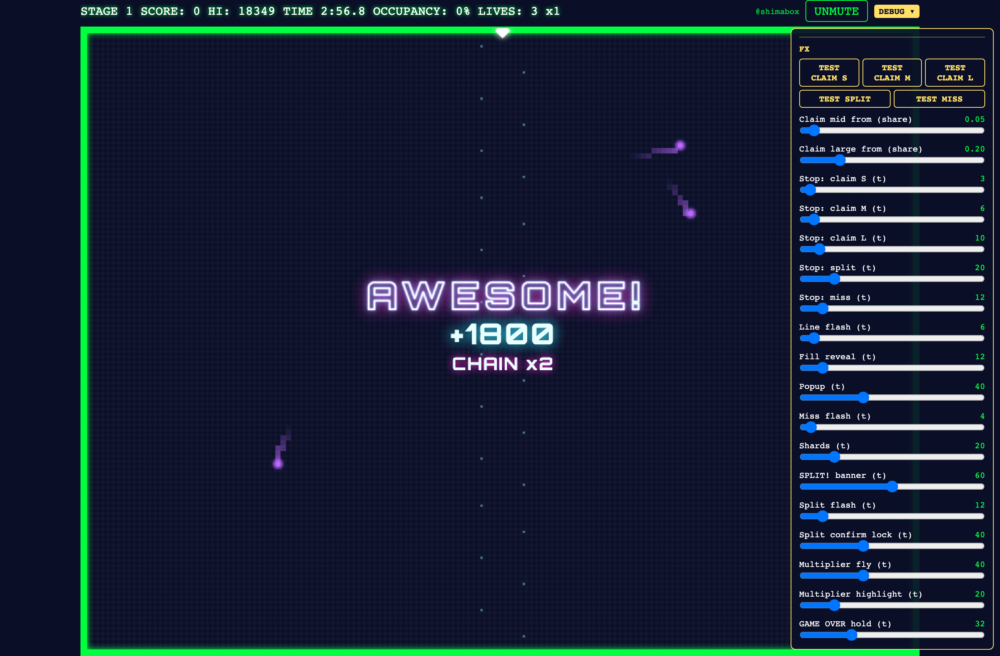
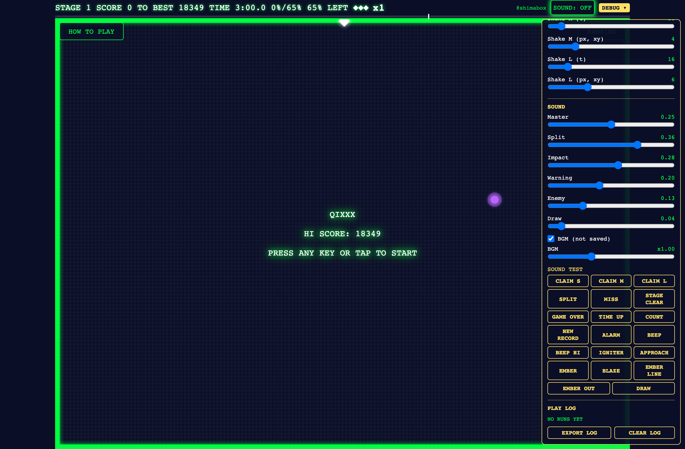

# QIXXX 開発ガイド

QIXXX を手元で開発するための情報（技術スタック、開発コマンド、文書用の画面写真の撮り直し、デバッグパネル、ディレクトリ構成）をまとめています。

## 技術スタック

- TypeScript (strict) + Canvas 2D — フレームワーク・ゲームエンジン不使用
- Vite（開発・ビルド） / Vitest（ユニットテスト） / Playwright（E2E スモーク）
- 効果音と BGM は Web Audio API による実行時生成（音源アセットなし）
- ホスティングは Cloudflare Pages（qixxx.orukubami.sh）
- X シェアのスコアカードは Cloudflare Pages Functions + Workers KV + workers-og（Satori）でエッジ動的生成
- スコアランキング（投稿・TOP 10・リプレイ）は Cloudflare Pages Functions + **Cloudflare D1** に保存。リプレイは投稿時の入力記録をクライアント側で再生

コアロジック（`src/core/`）は DOM・Canvas 非依存の純 TypeScript で、ユニットテストで網羅しています。

## 開発コマンド

```bash
npm run dev        # 開発サーバ起動
npm run build      # プロダクションビルド（dist/）
npm test           # ユニットテスト（Vitest）
npm run e2e        # E2E スモークテスト（Playwright）
npm run lint       # ESLint
npm run typecheck  # tsc --noEmit
npm run docs:shots # 文書用スクリーンショット（docs/images/）の撮り直し
```

`npm run e2e` と `npm run docs:shots` は Playwright の Chromium を使います。初めて流す前に `npx playwright install --with-deps chromium` で入れてください。

## 文書用の画面写真の撮り直し

`docs/images/` の画面写真（`readme-share-card.png` を除く）は `npm run docs:shots` で撮り直せます。ビルドしてローカルで配信し、偽装した時計と作りもののランキングで毎回同じ画面を撮ります（`npm run docs:shots -- hud wisp` のように名前を渡すとその画像だけ）。今の画像は macOS の Playwright Chromium で撮っています。画面が変わったら流し直してください。

## デバッグパネル

開発サーバで URL に `?debug` を付けると、ゲームの設定をスライダーで即時調整できるパネルが出ます（プロダクションビルドには含まれません）。スライダーは、ウィスプの数と速さ、エンバーの数・移動間隔・出現間隔・枝分かれで追ってくる確率、要求占有率、BIG CLAIM のしきい値と倍率、CLOSE CALL の距離とボーナス、ミス後の無敵と線を引けない時間、最初のエンバーまでの時間、制限時間です。下の `FX` の区画では、確定・分断・ミスの演出（止め・揺れ・表示の長さ・文字の裂け・火花・連続確定・スコアの数え上げなど）の数値を調整し、`TEST CLAIM S / M / L`・`TEST SPLIT`・`TEST MISS` で試し打ちできます。`TEST CLAIM` を続けて押すと、連続確定の表示と音の上がり方も確かめられます。この区画はプレイの設定を変えないので、使ってもハイスコアの保存やランキングの投稿に影響しません。`EXPORT` でチューニング結果を JSON として書き出せます（ゲームの設定に加えて、`FX` と `SOUND` の区画の値と、押したときのステージ `STAGE` も入ります）。`RESET HINTS` を押すと、遊びの中の案内の既読を消して、もう一度最初から出せます。

その下の `SOUND` の区画では、効果音の種類ごとの音量、BGM の入切（保存されません）と大きさを調整でき、`SOUND TEST` のボタンで音を 1 つずつ試聴できます。`PLAY LOG` の区画には、この端末のプレイ記録の集計（終わったステージ、ミスの内訳、スコアなど）が出ます。記録に残るのは、URL に `?seed=` を付けず、デバッグパネルでゲームの設定（上のスライダー）か制限時間を上書きしていない NORMAL のプレイのうち、新しいほうから 50 回です。EASY のプレイ、`?seed=` を付けたプレイ、ゲームの設定か制限時間を上書きしたプレイ（上書きしたあとに `RESET` で戻しても、そのプレイ）は残りません。`FX` や `SOUND` の値だけを変えたプレイは残ります。`EXPORT LOG` で記録を JSON として書き出し、`CLEAR LOG` で消せます。記録は端末の中だけに保存され、外へは送りません。





## ディレクトリ構成

```
src/
├── core/     # ゲームロジック（DOM 非依存・テスト対象の中心）
├── render/   # Canvas 描画（盤面・演出・案内の印・ステージの開始の合図・加速の輪）
├── input/    # キーボード・タッチ入力
├── audio/    # Web Audio の効果音と BGM
├── fx/       # 確定・分断・ミスの演出の時間割（止め・揺れ・ミスの理由など）
├── hints/    # 遊びの中の案内（いつ・どれを出すか）
├── i18n/     # 画面の文言（英語・日本語）と言語の判定
├── playLog/  # 端末内のプレイ記録とその集計
├── debug/    # 開発用のデバッグパネル（開発サーバだけ）
├── storage/  # localStorage（ハイスコア・音の設定・難易度の選択・案内の既読・プレイ記録）
├── config.ts # チューニング定数・配色・ステージの表
├── ui/       # タイトルのメニューと MODE ボタン、GAME OVER モーダル（X シェア・スコア投稿）、ランキング一覧・リプレイ、HOW TO PLAY、一時停止、案内の行
└── main.ts   # エントリポイント（結線・ゲームループ）
functions/    # Cloudflare Pages Functions（シェア API・OG カード生成・ランキング API）
scripts/
├── audit/       # ランキングのリプレイ監査
└── doc-shots/   # 文書用スクリーンショットの撮影（npm run docs:shots）
docs/
├── how-to-play.md               # 遊び方ガイド
├── development.md               # 開発ガイド
├── first-plan.md                # 最初の企画メモ
├── plan.md                      # 実装計画書
├── plan-cloudflare-x-share.md   # Cloudflare 移行と X シェアの計画書
├── cloudflare-setup.md          # Cloudflare 環境構築
├── ranking-schema.md            # ランキングの D1 スキーマ
├── ranking-runbook.md           # ランキング運用手順書（削除・シーズン・ルール変更）
├── ranking-audit-runbook.md     # リプレイ監査の手順書
├── ranking-cpu-measurement.md   # ランキング投稿の CPU 計測記録
├── perf-soak-baseline.md        # パフォーマンス計測記録
├── measurements/                # 計測のスクリプトと結果
├── security-review-2026-09-09.md     # セキュリティレビューの記録
├── adversarial-review-2026-09-13.md  # 敵対的レビューの記録
└── images/                      # 文書用スクリーンショット
```
