# QIXXX 遊び方ガイド

**QIXXX（キックス）** は、線を引いて陣地を切り取っていく「陣取りアクションゲーム」です。
敵に触れないように少しずつフィールドを塗りつぶし、**目標占有率に達したらステージクリア**です。目標はステージごとに決まっていて、60%〜80% です（ステージ 1 は 65%。一覧は 7 章）。

**1 プレイは実質 3 分間の時間制限つき。** 制限時間が尽きると、ライフが何個残っていても関係なく **TIME UP** でゲームオーバーになります。「3 分でどこまで稼げるか」が勝負です。

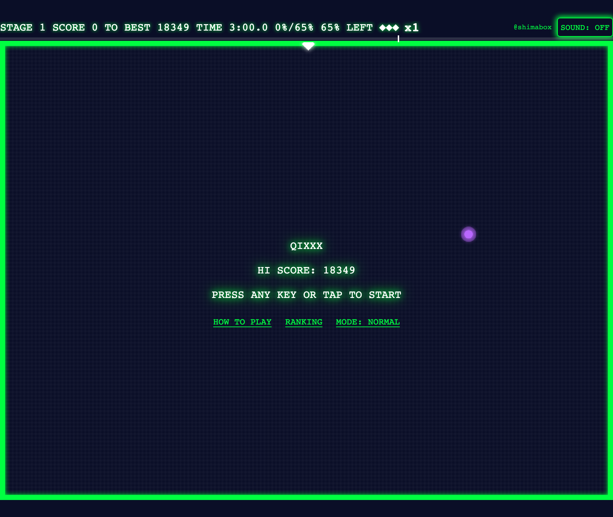

ブラウザで動きます。デスクトップ（キーボード）でもスマホ（タッチ）でも遊べます。

---

## 1. まず動かしてみる

**🎮 ブラウザですぐ遊べます: https://qixxx.orukubami.sh/**

ローカルで動かす場合:

```bash
npm install
npm run dev
```

表示された URL（例: `http://localhost:5173/`）を開くとタイトル画面が出ます。
**キーを押す（`Tab` を除く）か、盤面をタップ** するとゲームが始まります。スマホでは、十字キーや `FAST` / `SLOW` ボタンを押しても始まります。

- タイトルのボタンなどにフォーカスがあるあいだに押したキー（矢印キーも含む）では始まりません
- 盤面の外（右上の SOUND ボタンや、盤面のまわりの余白）や、タイトルのメニュー（ボタンと、ボタンのあいだも含むメニューの行）をタップしても始まりません

タイトルの文字の下には、左から **HOW TO PLAY**・**RANKING**・**MODE** の 3 つのボタンが並びます。広い画面では横 1 行、幅が足りない画面（例: 568×320）では縦に重ねて並びます（画面が狭いときは、盤面の下や盤面の下の縁に移ります）。
**RANKING** ボタンを押すと、オンラインランキングを開けます（詳しくは 10 章）。

ランキングに再生できる記録があると、タイトル画面の後ろでその上位のプレイが **お手本リプレイ** として音なしで流れます。ふだんは盤面の左下に `DEMO` と表示されます（メニューが盤面の下の縁に移ったときは左上）。ランキングを読み込めないとき、端末で動きを減らす設定にしているとき、URL に `?seed=` を付けた固定シードのページでは流れません。

### HOW TO PLAY

タイトル画面の **HOW TO PLAY** ボタンで、遊び方を 1 画面にまとめたパネルが開きます。線の引き方、陣地の取り方、敵のいない側が陣地になること、分断で一発クリアになることを 4 つの絵で示し、目標の % と 1 プレイ 3 分のこと、一時停止のキーも書いてあります。

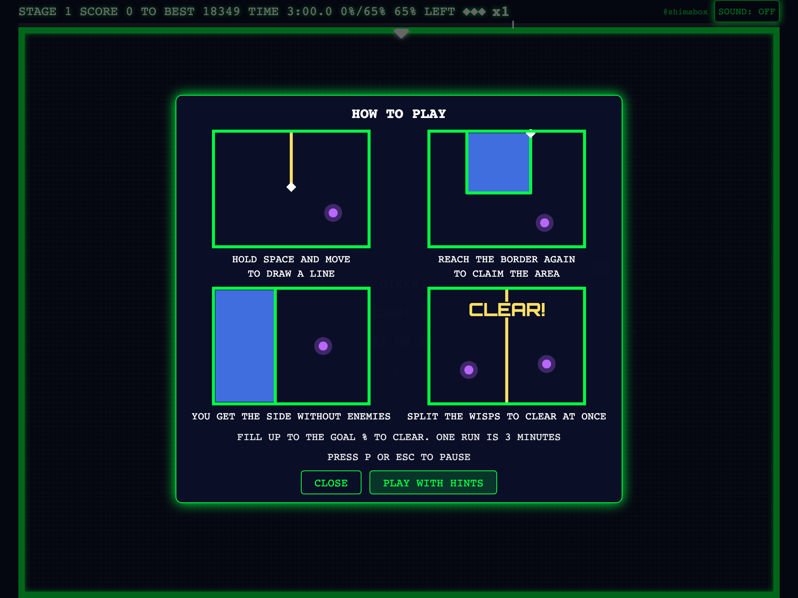

- **CLOSE** で閉じます
- **PLAY WITH HINTS** を押すと、遊びの中の案内（3 章の「遊びの中の案内」）をもう一度最初から出す状態にして、そのままゲームを始めます

### 難易度（NORMAL / EASY）

タイトル画面の **MODE** ボタンで難易度を選べます。押すたびに `MODE: NORMAL` と `MODE: EASY` が切り替わります。押してもゲームは始まりません。選んだ難易度は端末（ブラウザ）に保存され、次からも使われます。切り替えが効くのは、次に始めるプレイからです。

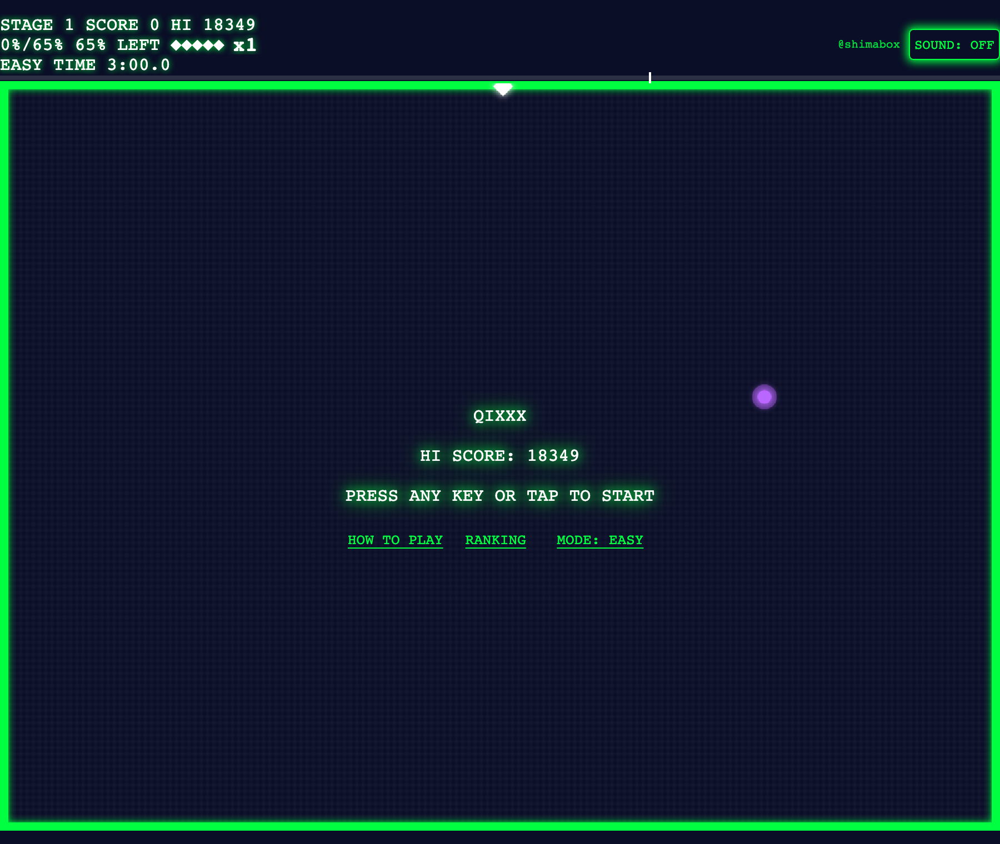

| | NORMAL | EASY |
|---|---|---|
| ウィスプの速さ | 各ステージの値（7 章の表） | 各ステージの値の 0.7 倍 |
| ライフ | 3 | 5 |
| 開始位置（4 章） | ステージ 2 から 4 つの辺の真ん中のどれか | どのステージも上の辺の真ん中 |
| ステージ 6 からの加速（7 章） | あり | なし |

制限時間、エンバー、目標占有率、得点のしかたは、どちらも同じです。

EASY のプレイでは、HUD（1 行のときは先頭、3 行のときは 3 行目の先頭）とゲームオーバー画面の `GAME OVER` の横に `EASY` と出ます。EASY のプレイは、ハイスコアにならず、ランキングに投稿できず、X へのシェア（POST TO X）もできません。端末のプレイ記録にも残りません。HUD の目標の表示は、NORMAL のハイスコアを `HI n` で示します。

NORMAL で序盤に終わるプレイが続くと、ゲームオーバー画面で EASY を勧めることがあります（9 章）。

### 日本語表示

ブラウザの言語が日本語のときは、案内やお知らせなどの文が日本語で表示されます。URL に `?lang=ja` を付けると日本語、`?lang=en` を付けると英語に固定できます。
HUD、見出し、ボタン、盤面の演出の文字は、どちらの言語でも英語のままです。ただし、ステージの始めに出る題のうちステージの名前（`WARM-UP` など。`STAGE n` は英語のまま）と、ゲームオーバー画面で EASY を勧める文は日本語になります。

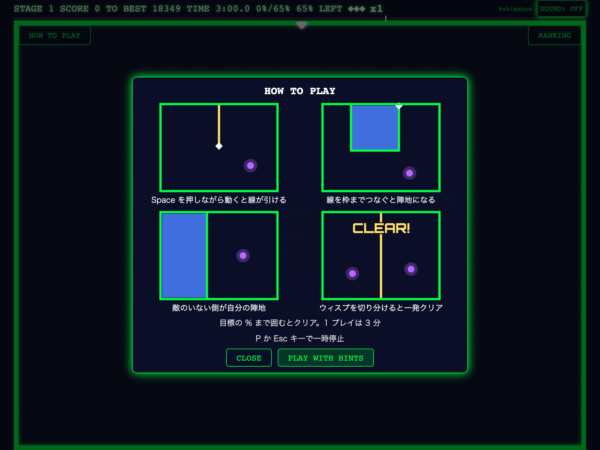

---

## 2. 画面の見方


広い画面では、HUD は `STAGE 1  SCORE 0  TO BEST 18349  TIME 3:00.0  0%/65% 65% LEFT  ◆◆◆  x1` のように 1 行に並びます。EASY のプレイでは、先頭に `EASY` が付き、目標の表示が `HI n`、ライフが 5 つになります（例: `EASY  STAGE 1  SCORE 0  HI 18349  TIME 3:00.0  0%/65% 65% LEFT  ◆◆◆◆◆  x1`）。


| 表示 | 意味 |
|---|---|
| `EASY` | EASY のプレイのときだけ、先頭に出ます |
| `STAGE 1` | 現在のステージ番号 |
| `SCORE` | 現在のスコア |
| `TO BEST 14898` など（目標の表示） | **いま追いかけている目標**。プレイを始めたときのハイスコアまで届いていなければ `TO BEST n`（あと n 点）。ハイスコアを超えると、ランキングの 10 位まで届いていなければ `TO #10 n`（あと n 点）、10 位も超えたら `TOP 10!`、ランキングを読み込めていないときは `NEW BEST!` になります。初めてのプレイで得点が 0 のあいだ、URL に `?seed=` を付けたプレイ、EASY のプレイ、リプレイでは、代わりにハイスコアが `HI n` と表示されます。ハイスコアはブラウザに保存され、次回も残ります |
| `TIME` | **残り時間のカウントダウン**（例 `2:59.9`）。1 プレイの持ち時間は実質 3 分固定で、0 になると即 TIME UP。**残り 30 秒を切ると文字色が警告色（赤）に変わります**。同時に警告音が 1 回鳴り、残り 15 秒でも同じ警告音がもう 1 回鳴ります（文字色は赤のまま変わりません）。残り 10 秒からは 1 秒ごとに「ピッ」と鳴ります（残り 5 秒からは高い音）。`SOUND: OFF` のときは鳴りません |
| `24%/65% 41% LEFT` | **占有率**。「今の占有率 / 目標の占有率　目標まで残り」の順です。占有率はフィールドの何 % を陣地にしたかで、目標（ステージごとに決まっています。7 章の表）に達するとクリア。HUD のすぐ下のゲージも占有率を表し、白い目盛りが目標の位置です |
| `◆◆◆` | 残りライフ。**NORMAL は 3、EASY は 5 からスタート**し、ミスで 1 つ減るごとに `◆◆◇` のように白抜きになります。**0 でゲームオーバー**（ライフが残っていても、TIME が 0 になれば同様にゲームオーバーです） |
| `x1` | 得点倍率（後述の「分断ボーナス」で上がります） |
| `SOUND: OFF` / `SOUND: ON` ボタン | 音のオン/オフ（下の「音と BGM」も参照）。**初回は `SOUND: OFF`** なので、音を出したいときは押して `SOUND: ON` にしてください。設定は保存されます |

画面の幅が狭いとき（スマホの縦向きなど）は、HUD が 3 行に分かれます。1 行目が `STAGE`・`SCORE`・`HI n`（ハイスコア）、2 行目が占有率・ライフ・倍率、3 行目が `TIME` と目標の表示です（目標の表示が `HI n` のときは 3 行目には出ません）。EASY のプレイでは、3 行目の先頭に `EASY` が付きます。

### 音と BGM

右上の **SOUND** ボタンで音のオン/オフを切り替えます。初回は `SOUND: OFF` で、タイトル画面ではボタンがゆっくり光って知らせます。

`SOUND: ON` にすると、ライン引き・エリア確定・ミスなどの効果音のほか、**プレイ中は BGM が流れます**。BGM はステージごとに曲が変わり、残り時間が少なくなるほど盛り上がります。タイトル画面、ゲームオーバー、リプレイ、一時停止のあいだは BGM は鳴りません。

---

## 3. 操作方法

### デスクトップ（キーボード）

| 操作 | キー |
|---|---|
| 移動 | 矢印キー / `H` `J` `K` `L`（Vim 風: H=左 J=下 K=上 L=右） |
| **高速ライン**を引く | `X` または `Space` を**押しながら**移動 |
| **低速ライン**を引く（高得点） | `Shift` または `Z` を**押しながら**移動 |
| 一時停止 / 再開 | `P` または `Esc` |
| 画面を進める（タイトル・ステージクリア） | `Tab` を除くキーを押す（ボタンなどにフォーカスがあるときは進みません） |
| ゲームオーバーから **もう一度（RETRY）** | `Tab` を除くキーを押す（タイトルへ戻るときは **TITLE** ボタン）。ゲームオーバー画面が出た直後や、ランキングの投稿フォームを待つあいだなど、キーが効かない時間があります（9 章） |
| 難易度を切り替える（タイトル） | **MODE** ボタン（1 章の「難易度」） |

### 一時停止

プレイ中に `P` か `Esc` を押す（スマホなら **PAUSE** ボタンを押す）と一時停止します。止めているあいだは盤面が隠れ、`PAUSED` と **RESUME** ボタンが出ます。もう一度 `P` か `Esc` を押すか、**RESUME** を押すと、止めたところから再開します。
ブラウザのタブを切り替えるなどしてページが隠れたときも自動で一時停止し、戻ってきても止まったままです。
一時停止できるのはプレイ中だけです（タイトル、ステージクリア、ゲームオーバー、リプレイでは止まりません）。

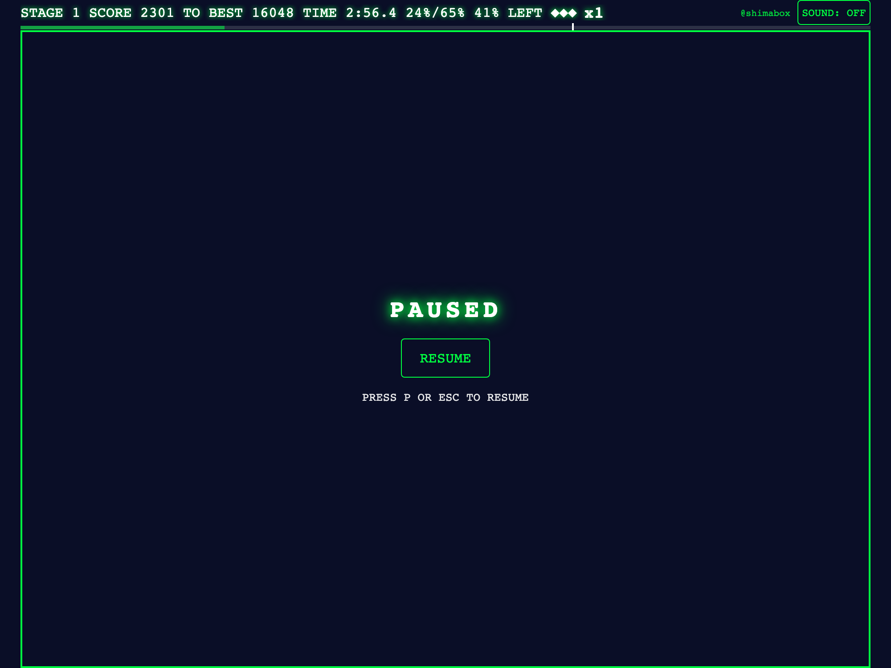

> ⚠️ **文字キー（H/J/K/L/X/Z）が効かないときは:** Vimium などのブラウザ拡張がキーを横取りしているか、日本語入力（IME）が ON になっています。矢印キーと Space だけ効くのが典型的な症状です。**シークレットウィンドウで開く**・拡張の除外サイトに追加する・英数モードに切り替える、のいずれかで解決します。

### スマホ（タッチ）

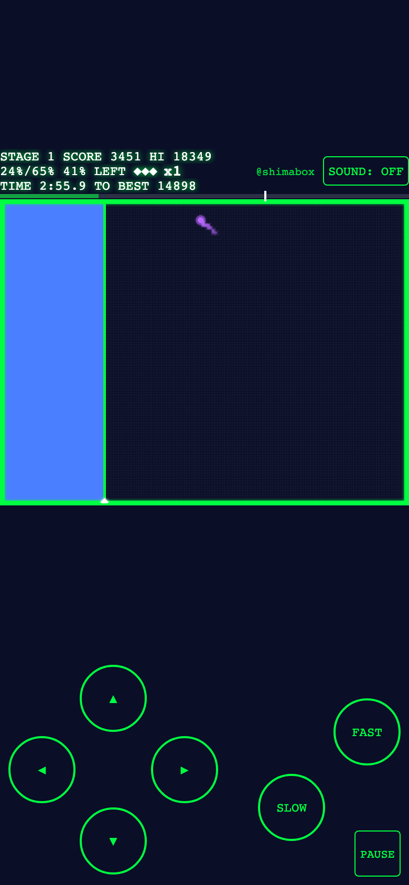

- **十字キー**で移動、**`FAST` / `SLOW` ボタン**がライン用ボタンです。縦向きでは、どちらも盤面の下に並びます
- ボタンを**押しながら**十字キーを押すとラインが引けます（同時押し対応）
- **`PAUSE` ボタン**で一時停止します（再開は **RESUME** ボタン）
- タイトルなどの画面は、**盤面をタップ**するか、十字キーや `FAST` / `SLOW` ボタンを押すと進みます。盤面の外（SOUND ボタンや余白）や、タイトルのメニューの行をタップしても進みません

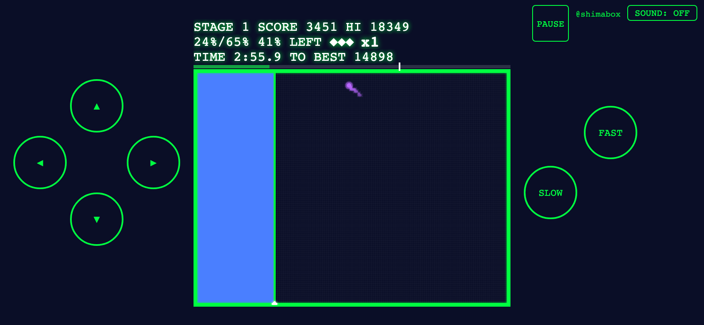

スマホを横向きにすると、多くの端末では十字キーが盤面の左、`FAST` / `SLOW` ボタンが盤面の右に並び、`PAUSE` ボタンは右上に出ます（画面の幅や高さによっては、横向きでも盤面の下に並ぶことがあります）。

### 遊びの中の案内

初めての場面では、盤面の内側の下寄りに 1 行の案内が出ます（日本語表示では日本語）。マーカーが盤面の下のほう（高さの下から 35% の範囲。下の辺の上も含む）にいるあいだは、案内は盤面の内側の上寄りへ移ります。最初は線の引き方が、陣地を初めて取ると「敵のいない側が自分の陣地になる」ことが、2 回取ったあとは「低速ラインは得点 2 倍」の案内が出ます。ほかに、ウィスプが 2 匹以上のステージに入ったとき（分断）と、エンバー・ブレイズ・イグナイターが初めて出たときにも、それぞれ 1 回ずつ出ます。案内に合わせて、盤面に矢印や目印の輪が出ることもあります。

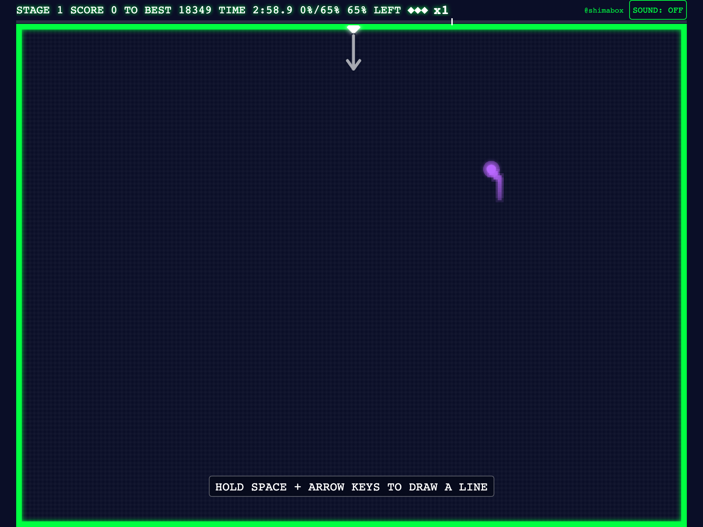

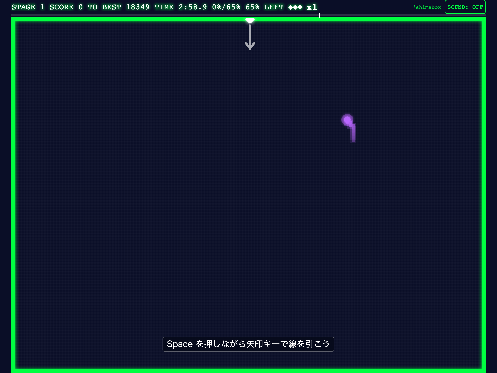

- 一度出た案内は端末（ブラウザ）に記録され、次からは出ません。ただし、線の引き方の案内は最初に陣地を取るまで、低速ラインの案内は 3 回目以降の確定を低速ラインで取るか、案内が合わせて約 10 秒出るまで記録されません。記録されないままプレイが終わると、次のプレイでもまた出ます
- もう一度最初から見たいときは、タイトル画面の **HOW TO PLAY** から **PLAY WITH HINTS** を押します
- スマホでは、操作に合わせた文になり、使うボタン（`FAST` / `SLOW`）が光ります

---

## 4. 基本ルール — 線を引いて陣地を取る

### 4-1. ステージの始まり

ステージ 1 は、マーカーが上の辺の真ん中から始まります。ステージ 2 からは、4 つの辺（上・右・下・左）の真ん中のどれかから始まります（EASY では、どのステージも上の辺の真ん中から）。

ステージの始めには、マーカーに向かって縮む輪と、ステージの題（`STAGE n` とステージの名前）が約 1 秒出ます。端末で動きを減らす設定にしていると、輪は縮まず、大きさが一定のまま薄くなります。プレイは題が消えるのを待たずに始まっています。

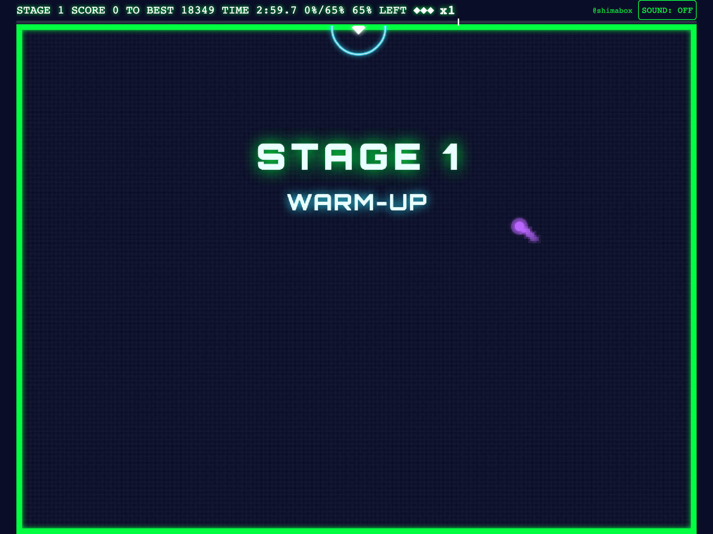

### 4-2. ふだんは「枠の上」しか動けない

白い点があなたの操作する **マーカー（自機）** です。
マーカーは**緑色の境界線の上だけ**を自由に移動できます。フィールドの内側には勝手に入れません。

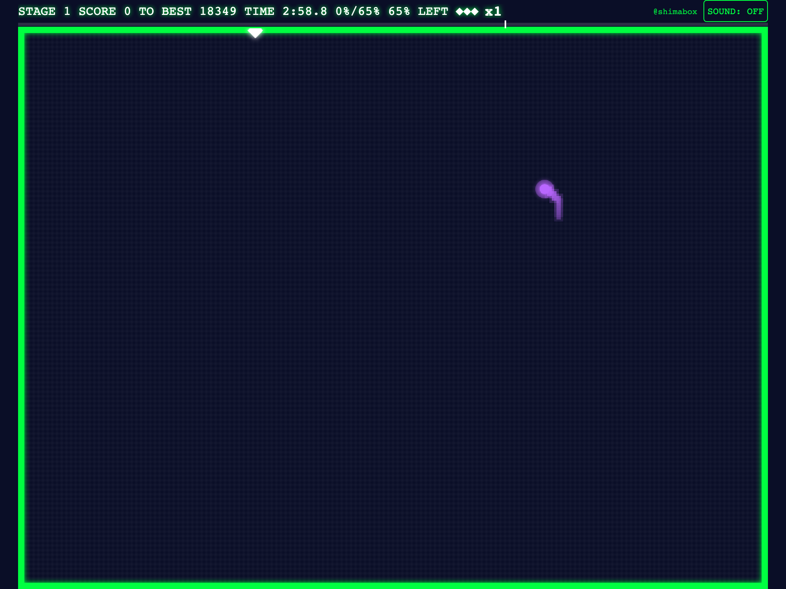

### 4-3. ラインボタンを押しながら進むと「線」が引ける

`X`/`Space`（または `FAST` ボタン）を**押しながら**フィールド内側へ進むと、
移動した跡が**黄色いライン**になります。

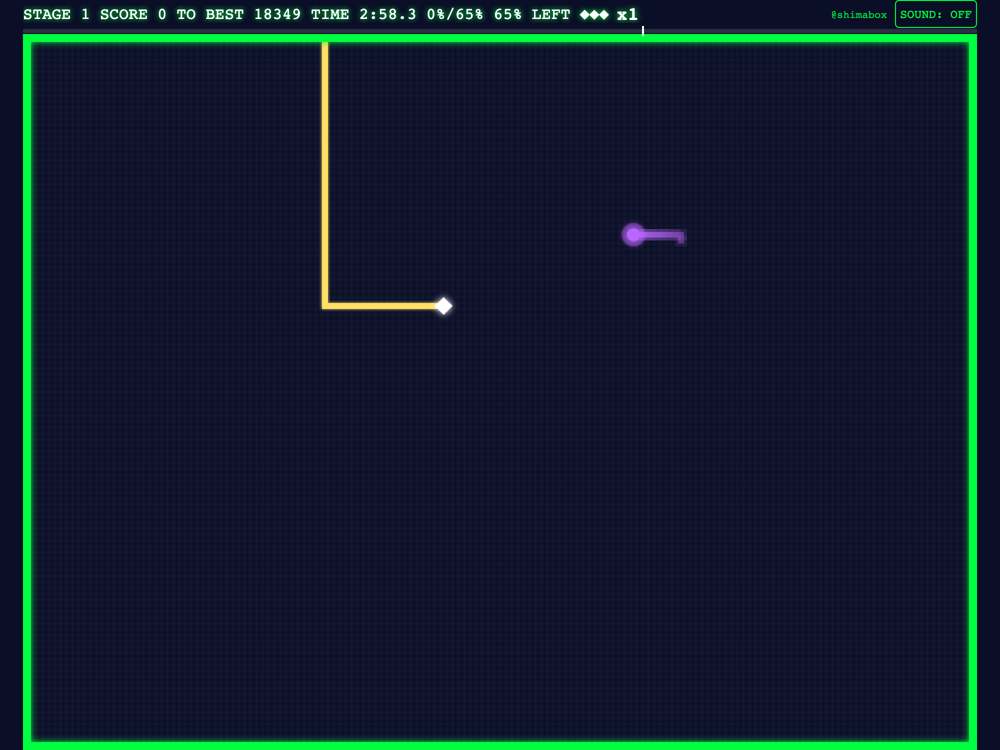

### 4-4. 反対側の境界線に届くと、面が確定する

ラインが別の境界線にたどり着くと線が閉じて、**フィールドが分かれ、
「敵がいない側」が自分の陣地として塗りつぶされます**。

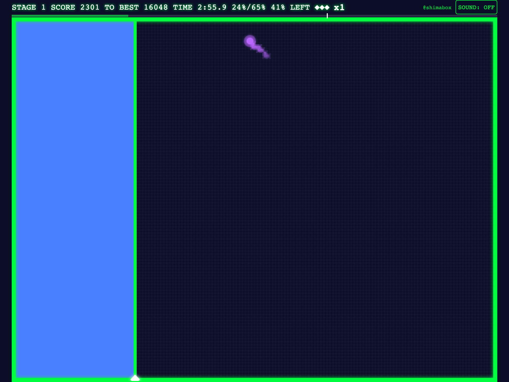

- 塗られた分だけ **占有率（HUD の `24%/65%` の左の数字）が増え、スコアが入ります**
- ウィスプがみな同じ側にいるときは、その側は塗られません。**敵をどれだけ狭い場所に追い込んで大きく塗るか**がこのゲームの醍醐味です
- ウィスプが分かれた側にいるとき（分断）は、塗られる側の決まりが違います（8 章）

### 4-5. 低速ライン（SLOW）は倍のスコア

`Shift`/`Z`（または `SLOW` ボタン）で引くと移動速度が**半分**になる代わりに、
確定したエリアの得点が **2 倍**になります。低速で取ったエリアは**赤色**で塗られます。

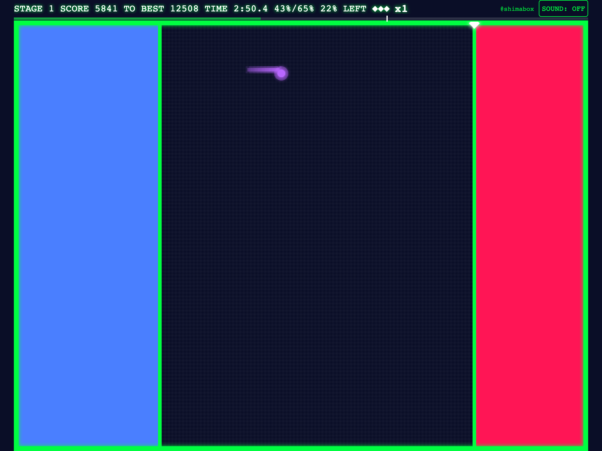

> ⚠️ 1 本のラインの途中で高速・低速を切り替えた場合、閉じたときに高速で引いた部分が少しでも残っていれば「高速で引いた」扱いになります。
> 2 倍になるのは、残っているラインがすべて低速で引いた部分のときです（高速で引いた部分を引き戻して消し、低速の部分だけで閉じた場合も含みます）。

### 4-6. 引き返したくなったら「引き戻し」

ラインを引いている途中で**来た道を逆方向に入力**すると、ラインを末尾から消しながら後退できます。
開始地点まで戻れば、何もなかったことにしてやり直せます。

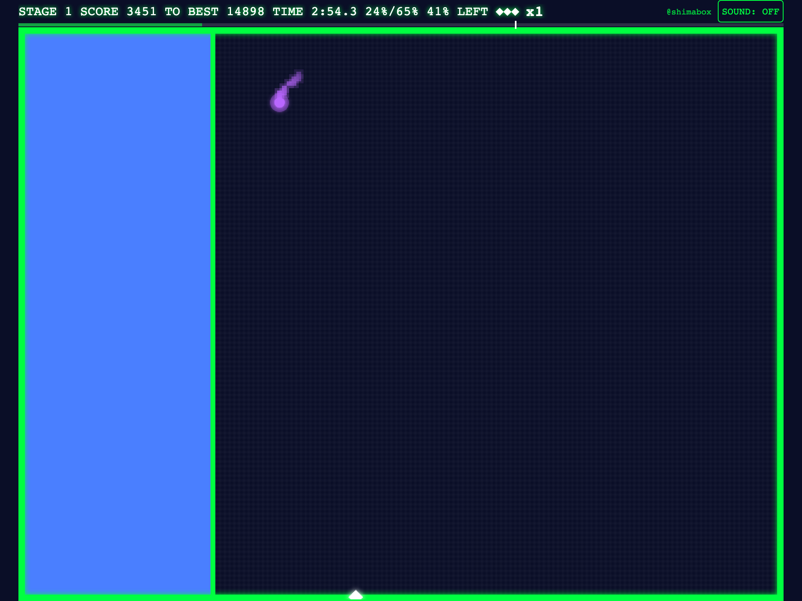

> ⚠️ 後述の**イグナイター（導火線の敵）が出現すると引き戻しできなくなります**。

---

## 5. 敵は 3 種類

### ウィスプ（Wisp）— フィールド内をさまよう本体

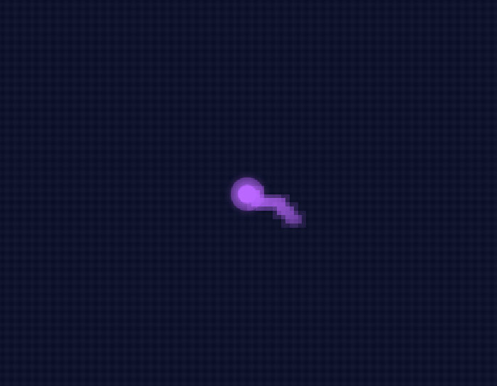

- フィールドの**未確定エリア内**をランダムに漂います
- **引いている途中のラインやマーカーに触れられるとミス**
- 確定済みの境界線の上にいるマーカーには**無害**です。枠の上にいれば安全
- ウィスプがみな同じ側にいれば、その側は陣地にならないので、動きを読んで反対側を切り取りましょう
- ステージ 6 からは、陣地を取って目標に近づくほど速くなります（7 章の「ステージ 6 からの加速」）

### エンバー（Ember）— 境界線を巡回する追っ手


- 決まった間隔ごとに**画面上部の角から**現れ、**境界線の上**を移動してマーカーを追いかけます。同時に出ていられる数には上限があり、出る時点で上限まで 2 体以上の空きがあれば上の 2 つの角から 2 体、1 体分の空きなら左上の角から 1 体だけ出て、空きがなければ出ません（例: ステージ 2 の上限は 3 体なので、最初の 2 体が残っていれば次は 1 体）
- 最初のエンバーが出るのは、ステージ 1 では約 15 秒後、ステージ 5 と 12 では約 3 秒後、ほかのステージでは出現の間隔と同じ時間のあとです（7 章の表）
- **接触するとミス**。枠の上に居座っていると追い詰められます
- ライン引き中（フィールド内側）には追ってこられません
- ただし、ステージの **2 回目の出現から現れる深紅の個体（ブレイズ）** は例外で、引いている途中のライン上にも根元から登ってきます。出現の回は、上限で出なかった回も 1 回と数えます（出なかった回のあとに出る組もブレイズになることがあります）

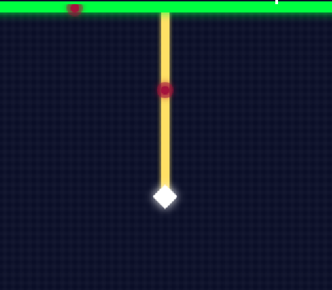

- ブレイズもエンバーと同じく**接触するとミス**。ラインを閉じると、ふつうは境界の巡回に戻ります（足元がその確定で陣地に取り込まれたブレイズは、そこで消えます）。ミスでラインが消えると足場を失って消滅します

### イグナイター（Igniter）— ラインを伝う導火線

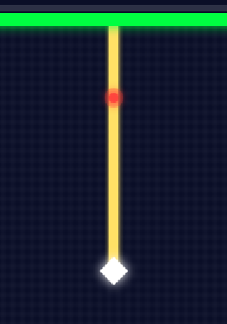

- ライン引きの途中で**方向キー（十字キー）を約 1 秒離していると**、ラインの根元から出現します
- 出現したあとは、**方向を入力していない間だけ**ライン上を迫ってきます。方向を入力すれば止まります。進めない方向を押し続けてマーカーが止まっているあいだも、出現の待ち時間は進まず、迫ってもきません
- **追いつかれるとミス**。出現したら引き戻しもできません — 迷わず線を引き切りましょう

---

## 6. ミスとライフ


ミスになるのは次の 4 つです。ミスをすると、盤面にその理由が一瞬表示されます（日本語表示では日本語）。

| ミスの理由 | 盤面の表示 |
|---|---|
| ウィスプが引いている途中のライン（またはライン上のマーカー）に触れた | `WISP HIT YOUR LINE`（ウィスプが線に触れた） |
| エンバーがマーカーに接触した | `EMBER HIT YOU`（エンバーにぶつかった） |
| ブレイズがマーカーに接触した | `BLAZE HIT YOU`（ブレイズにぶつかった） |
| イグナイターに追いつかれた（ラインの途中で止まりすぎた） | `STOPPED TOO LONG`（立ち止まりすぎた） |

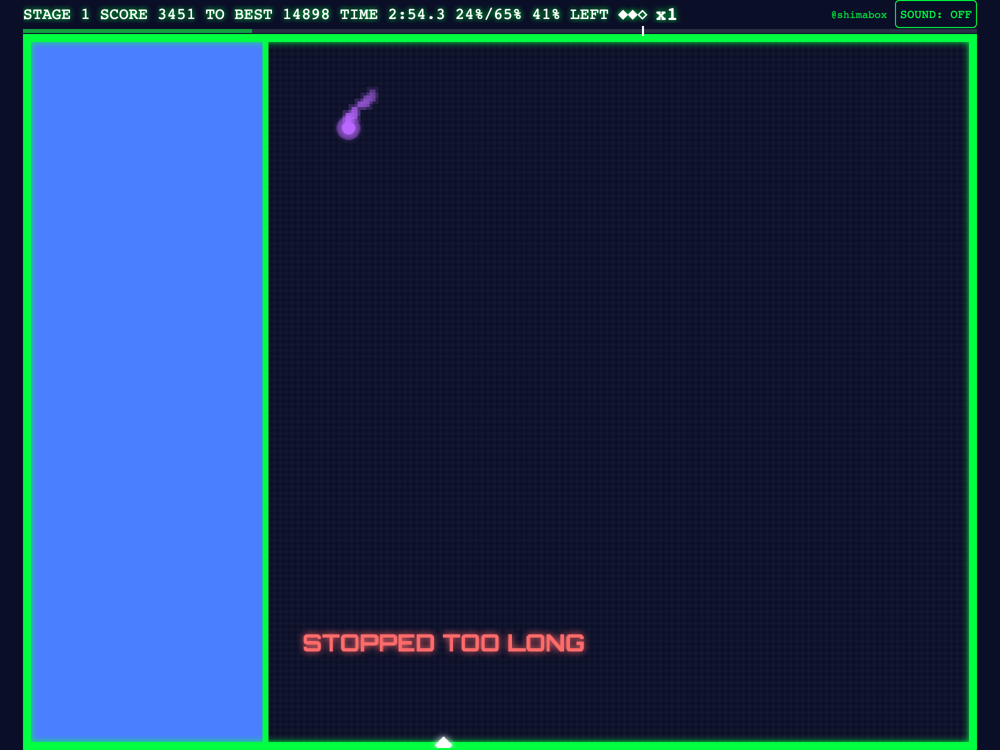

ミスをすると:

- 引いていたラインは**消滅**し、マーカーは**ライン開始地点に戻ります**
- **ライフが 1 減り**、得点倍率が **x1 にリセット**されます
- 直後の **約 1 秒間は無敵**です。そのうち最初の **約 0.5 秒** は新しくラインを引き始めることができません（境界線の上を移動して立て直すことはできます）

**ライフが 0 になるとゲームオーバー**です。（**残り時間が 0 になった場合も、ライフの残数にかかわらず TIME UP でゲームオーバー**になります — 詳しくは 9 章）

---

## 7. ステージクリアと難易度

占有率が目標値に達した瞬間、ステージクリアです。目標を超えた分は**ボーナス得点**になります（分断でクリアしたステージにはつきません）。

クリア画面では、そのステージの得点の内訳が 0 から数え上がって表示されます。

| 表示 | 意味 |
|---|---|
| `AREA` | そのステージで陣地を取って得た点。BIG CLAIM の 1.5 倍を含む面積の得点と、CLOSE CALL のボーナスが入ります（11 章） |
| `BONUS` | 占有率でクリアしたときの、目標を超えた分のボーナス（分断でクリアしたステージでは 0） |
| `TOTAL` | `AREA` と `BONUS` の合計 |
| `NEXT` | 次のステージの得点倍率 |

数え上げの途中でキーを押すと（タップすると）すぐに最後まで表示され、もう一度押すと次のステージへ進みます。

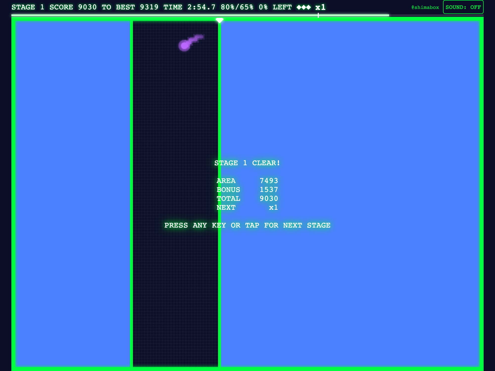

### ステージの一覧

ステージごとに性格が違います。ステージ 2 は速いウィスプが 1 匹、ステージ 3 で初めて 2 匹になって分断ができるようになります。ステージ 4 と 11 は遅いウィスプがたくさんいる稼ぎどころ、ステージ 6 は息抜き、ステージ 5 と 12 はエンバーが多いステージです。

| ステージ | 題（日本語表示） | ウィスプ | 速さ | 目標 | エンバーの出現間隔 | 最初のエンバー | エンバーの同時数の上限 | エンバーの移動間隔 |
|---|---|---|---|---|---|---|---|---|
| 1 | WARM-UP（はじまり） | 1 匹 | x1.0 | 65% | 30 秒 | 15 秒 | 2 体 | 3 tick |
| 2 | SPRINTER（速い 1 匹） | 1 匹 | x2.4 | 70% | 18 秒 | 18 秒 | 3 体 | 2 tick |
| 3 | FAST PAIR（速い 2 匹） | 2 匹 | x2.4 | 72% | 16 秒 | 16 秒 | 4 体 | 2 tick |
| 4 | SLOW SWARM（遅い群れ） | 6 匹 | x1.2 | 60% | 20 秒 | 20 秒 | 4 体 | 2 tick |
| 5 | EMBER RUSH（エンバーの群れ） | 3 匹 | x2.4 | 75% | 10 秒 | 3 秒 | 6 体 | 2 tick |
| 6 | BREATHER（息抜き） | 2 匹 | x1.6 | 60% | 26 秒 | 26 秒 | 2 体 | 3 tick |
| 7 | QUARTET（4 匹） | 4 匹 | x2.4 | 78% | 15 秒 | 15 秒 | 6 体 | 2 tick |
| 8 | FAST FOUR（速い 4 匹） | 4 匹 | x2.8 | 80% | 12 秒 | 12 秒 | 7 体 | 2 tick |
| 9 | QUINTET（5 匹） | 5 匹 | x2.8 | 80% | 10 秒 | 10 秒 | 8 体 | 1 tick |
| 10 | FAST FIVE（速い 5 匹） | 5 匹 | x3.0 | 80% | 8 秒 | 8 秒 | 8 体 | 1 tick |
| 11 | BIG SWARM（大きな群れ） | 8 匹 | x1.4 | 65% | 16 秒 | 16 秒 | 4 体 | 2 tick |
| 12 | EMBER STORM（エンバーの嵐） | 3 匹 | x2.8 | 78% | 6 秒 | 3 秒 | 10 体 | 1 tick |
| 13 | SEXTET（6 匹） | 6 匹 | x2.6 | 80% | 10 秒 | 10 秒 | 8 体 | 1 tick |
| 14 | FAST SIX（速い 6 匹） | 6 匹 | x3.0 | 80% | 8 秒 | 8 秒 | 8 体 | 1 tick |
| 15 | FINAL（最終） | 7 匹 | x3.0 | 80% | 8 秒 | 8 秒 | 10 体 | 1 tick |

- **ステージ 16 以降**は、ステージ 15 の値のまま、1 ステージごとにウィスプが 1 匹増えます（ステージ 16 は 8 匹、17 は 9 匹、18 からは上限の 10 匹）。題は FINAL です
- 速さは、ステージ 1 のウィスプを x1.0 とした倍率です。EASY では、この 0.7 倍になります。NORMAL のステージ 6 からは、下の「加速」がかかります
- エンバーの移動間隔は、エンバーが 1 マス進むのにかかる時間です（60 tick = 1 秒。小さいほど速い）
- 「最初のエンバー」は、ステージが始まってから最初のエンバーが出るまでの時間です

スコアとライフは次のステージに引き継がれます。

### ステージ 6 からの加速

NORMAL のステージ 6 からは、陣地を取って占有率が目標に近づくほど、ウィスプが速くなります（ステージ 1〜5 と EASY では速くなりません）。

| 段 | なる条件 | ウィスプの速さ |
|---|---|---|
| 1 段目 | 占有率が目標の半分を超える | ステージの速さの 1.15 倍 |
| 2 段目 | 占有率が目標まで 10 ポイント以内になる | ステージの速さの 1.3 倍 |

たとえばステージ 6（目標 60%）では、30% を超えると 1 段目、50% から 2 段目です。

- 段は陣地を確定したときに決まり、そのステージのあいだは下がりません。次のステージでは元に戻ります
- 段が上がると、ウィスプの頭の色が変わります（1 段目と 2 段目で別のピンク）
- その確定のあともプレイが続くときは、それぞれのウィスプの頭から輪が広がり、`SOUND: ON` なら短い音が鳴ります。目標に届いた確定や分断の確定でステージが終わるときは、段と頭の色は変わりますが、輪と音は出ません。同じ瞬間に TIME UP になった確定でも、輪と音は出ません。端末で動きを減らす設定にしていると、輪は広がらず、大きさが一定のまま薄くなります

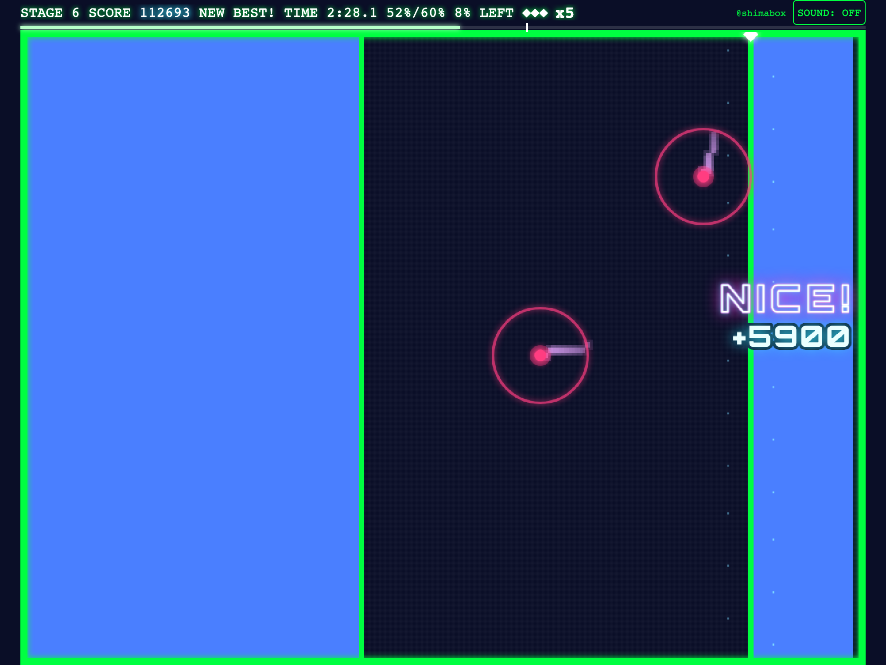

---

## 8. 分断ボーナス — 一発逆転の大技

ウィスプが **2 匹以上**になるのはステージ 3 からです（ステージ 2 は速いウィスプが 1 匹。数はステージごとに決まっています。7 章の表）。

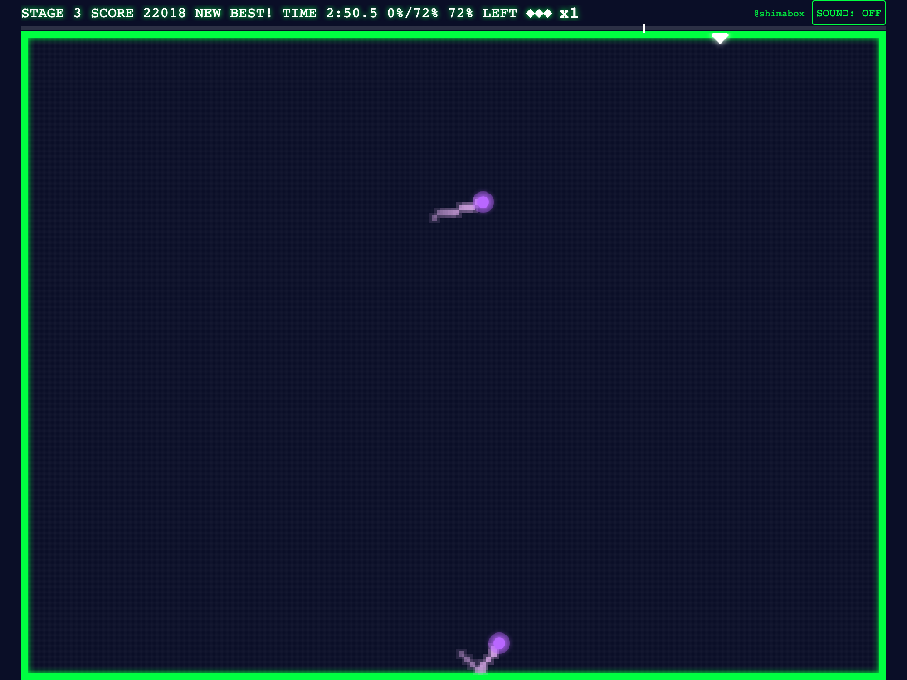

ここで狙えるのが**分断（スプリット）**です。
**ウィスプたちを 1 本のラインで別々の領域に切り分ける**と——

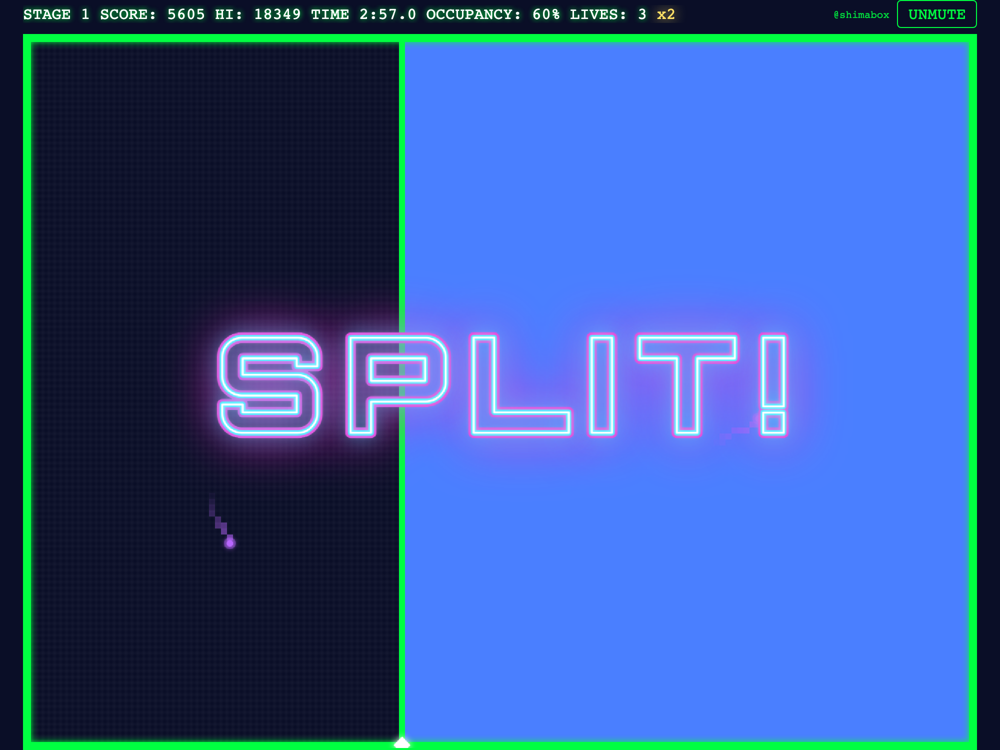

- **占有率に関係なく、その場で即ステージクリア!**（たとえ 10% 台でも）。盤面に **SPLIT!** が出て、それが消えるとステージクリアの表示に変わります
- さらに次のステージから**得点倍率が上がります**。上がる幅は、分けた 2 つの側のうち、ウィスプが少ない側の数です（最低 +1。1 匹と 1 匹に分ければ +1、3 匹と 3 匹に分ければ +3）。最大 x9 です
- ただし**一度でもミスすると倍率は x1 に戻ります**

分断のときに塗られる側は、ふつうの確定と決まりが違います。ゲームはウィスプのうち 1 匹を基準にしていて、**残るのは基準のウィスプがいる側だけ**です。ほかの側は、ウィスプがいても塗られます。

分断の形は 2 通りあります。どちらも成立します。

1. **真っ二つ**: フィールドを横断するラインで、ウィスプを左右（上下）の別領域に分ける
2. **閉じ込め**: ウィスプを小さく囲い込む。中のウィスプと外のウィスプが「別々の領域」になるので分断成立。囲った中に基準のウィスプがいれば外側が塗られ、基準のウィスプが外にいれば囲った側が塗られます

ハイスコアを狙うなら、リスクを取ってでも分断を決め続けるのが最短ルートです。

---

## 9. ゲームオーバーとハイスコア

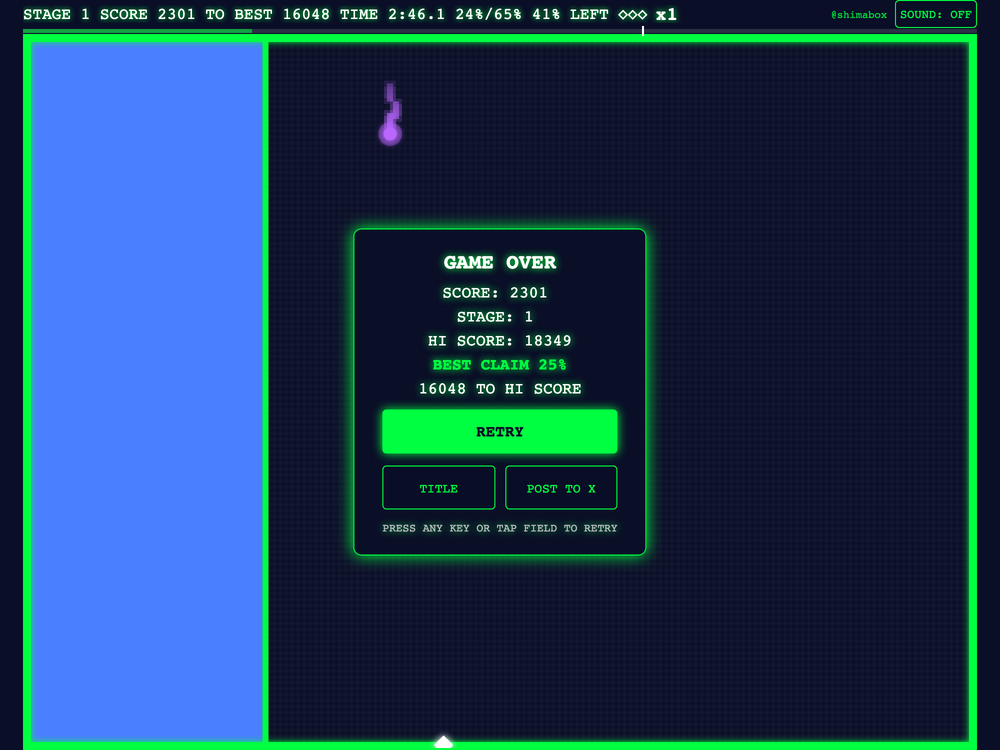

ゲームオーバーになるのは次の 2 パターンです。

- **ライフが 0 になった**（通常のゲームオーバー）
- **制限時間（実質 3 分）が 0 になった** — この場合はライフの残数に関係なく、画面に **TIME UP!** と表示されてゲームオーバーになります

ゲームオーバー画面では、スコアが 0 から数え上がって表示され、続いてそのプレイの**見せ場**が 1 行出ます。見せ場は次のうち最初に当てはまるものです（陣地を 1 回も取らなかったプレイでは出ません）。

| 表示 | 意味 |
|---|---|
| `SPLIT ×n` | 分断に n 回成功した |
| `BEST CLAIM n%` | 1 回で取った陣地のうち最も大きいものが n%。20% 以上を一度に取ったとき（ステージ 1 で終わったプレイでは 20% 未満でも） |
| `REACHED STAGE n` | 上のどちらにも当たらず、ステージ 2 以降の n まで進んだ |

**EASY を勧める表示:** 端末のプレイ記録に残ったプレイ（URL に `?seed=` を付けず、デバッグパネルでゲームのルールか制限時間を上書きしていない NORMAL のプレイ）が、そのプレイを含めて新しいほうから 3 回続けてステージ 3 までで終わると、そのプレイのゲームオーバー画面では、見せ場の代わりに `TRY EASY MODE ON TITLE`（日本語表示では「タイトルで EASY を選べます」）が出ます。

- 記録に残らないプレイ（EASY、`?seed=` を付けたプレイ、ルールか制限時間を上書きしたプレイ）は、回数に入らず、続きも途切れさせず、そのプレイのゲームオーバーでは出ません。音量や演出の値だけを変えたプレイは記録に残り、回数に入ります
- この表示が画面に出たあとに **TITLE** でタイトルに戻ると、タイトル画面の **MODE** ボタンが光ります（押すか、プレイを始めると消えます）。表示が出る前（数え上げの途中や、投稿フォームに隠れているあいだ）に TITLE を押したときは光りません

その下に、ハイスコアに届かなかったときは `n TO HI SCORE`（ハイスコアまであと n 点）、ハイスコアを更新したときは `NEW RECORD +n`（前のハイスコアより n 点多い）が出ます。この行は、ハイスコアを保存する通常のプレイだけに出ます（URL に `?seed=` を付けたプレイ、EASY のプレイ、デバッグパネルでゲームのルールか制限時間を上書きしたプレイでは出ません）。

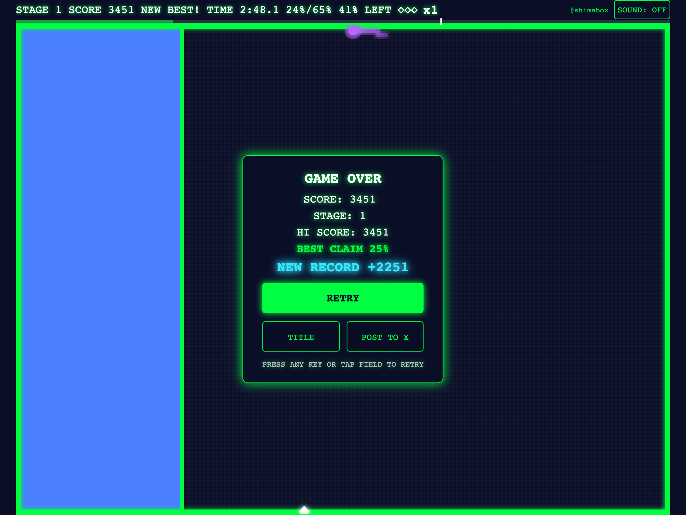

ボタンは次の 3 つです。EASY のプレイでは **POST TO X** が出ず、`GAME OVER` の見出しの横に `EASY` と出ます。

- **RETRY** — ステージ 1 から始め直します。`Tab` を除くキーを押す、または盤面をタップしても RETRY になります（下の「キーやタップが効かない時間」を参照）
- **TITLE** — タイトル画面に戻ります
- **POST TO X** — そのプレイのスコア・到達ステージを X にシェアできます（スコア入りカード画像付き）

**キーやタップが効かない時間:** 次のあいだは、キー・盤面のタップ・スマホのボタンを押しても RETRY になりません。

- ゲームオーバー画面が出てから最初の 24 tick（約 0.4 秒）
- ランキングの順位の照会の応答を待つあいだ（画面が出てから最大 90 tick、約 1.5 秒）
- 投稿フォーム（10 章）か、確定回数が多すぎるお知らせを開くと決まってから、開くまでのあいだ
- 投稿フォームが出ているあいだ

ゲームオーバー画面の **RETRY** ボタンは、照会の応答を待つあいだは押せば効きますが、フォームかお知らせを開くと決まってから開くまでは効きません（フォームが開いたあとは、フォームの下の **RETRY** を使えます）。照会やフォームを待つあいだも **TITLE** ボタンは使えます。

スコアが **TOP 10** に入る見込みのときは、ゲームオーバー画面に **YOU MADE THE TOP 10!** と投稿フォームが表示されます。フォームが出るのは、早くても、スコアの数え上げと最後の行が出そろってから約 1.5 秒（90 tick）後です。順位の照会の応答がそれより遅いときは、応答が届いたときに出ます。投稿の方法は次の 10 章を参照してください。
**ハイスコアはブラウザに自動保存**され、次回起動時のタイトル画面に表示されます（EASY のプレイのスコアはハイスコアになりません）。このハイスコアは端末（ブラウザ）ごとの記録で、全プレイヤー共通のオンラインランキングとは別物です。

> 記録（ハイスコア）をリセットしたい場合は、ブラウザの開発者ツールを開き、localStorage から `qixxx.highScore` を削除してください。

---

## 10. スコアランキングとリプレイ

### 10-1. ランキングとは

全プレイヤー共通のオンラインランキングです。掲載されるのは**上位 10 件だけ**です。

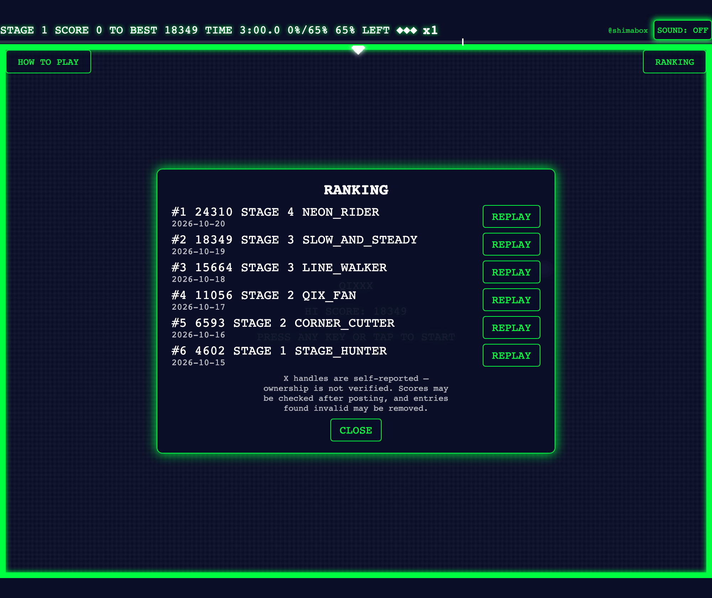

- タイトル画面の、タイトルの文字の下のメニューにある **RANKING** ボタンで開き、**CLOSE** で閉じます
- 各行には順位・スコア・到達ステージ・名前（または X ハンドル）と、投稿された日付が並びます
- エントリがまだないときは `NO ENTRIES YET` と表示されます
- 日本語表示では、注意書きや読み込み中・エラーのお知らせなどの文が日本語になります（順位の行やボタンは英語のまま）
- **RANKING** ボタンがあるのはタイトル画面だけです。プレイ中は開けません

### 10-2. 投稿できる条件

ゲームオーバー画面に投稿フォームが表示されるのは、次の条件をすべて満たしたときです。

1. **通常の NORMAL のプレイであること。** EASY のプレイ、URL に `?seed=` を付けた固定シードのプレイ、デバッグパネルでゲームのルールか制限時間を上書きしたプレイは対象外です（音量や演出の値だけを変えたプレイは対象です）
2. **スコアが、確認済みのスコアの 10 位を上回ること。** 同点は対象外です。確認済みのスコアが 10 件に満たないときは、どのスコアでも投稿フォームが表示されます。この判定には確認待ちの投稿を含めないため、一覧では 10 位以内に届かないように見えるスコアでも、投稿できることがあります
3. **面の確定回数が上限（300 回）以内であること。** 2 を満たしていても、上限を超えたプレイは投稿できません。この場合はフォームの代わりに `TOO MANY AREA CLAIMS TO VERIFY (n > 300) — THIS RUN CANNOT BE RANKED.`（n はそのプレイの確定回数。日本語表示では「確定の回数が多すぎて検証できません（n > 300）。このプレイはランキングに載せられません」）と表示されます

1 または 2 を満たさないときは、投稿フォームもメッセージも表示されず、通常のゲームオーバー画面だけになります。

> ⚠️ **投稿は一度きりです。** ゲームオーバー画面から離れると（**RETRY** でもう一度遊ぶ、**TITLE** でタイトルに戻る）、そのプレイは投稿できなくなります。フォームかお知らせを開くと決まってから開くまでのあいだは、キーや盤面のタップでも、ゲームオーバー画面の **RETRY** ボタンでも RETRY になりません（**TITLE** は使えます）。フォームが出ているあいだも、キーや盤面のタップでは RETRY になりません（フォームの下の **RETRY** / **TITLE** は使えます）。フォームの **SKIP** で閉じたあとは、キーやタップで RETRY できます。キーやタップが効かないほかの時間は、9 章の「キーやタップが効かない時間」を参照してください。

### 10-3. 投稿の流れ

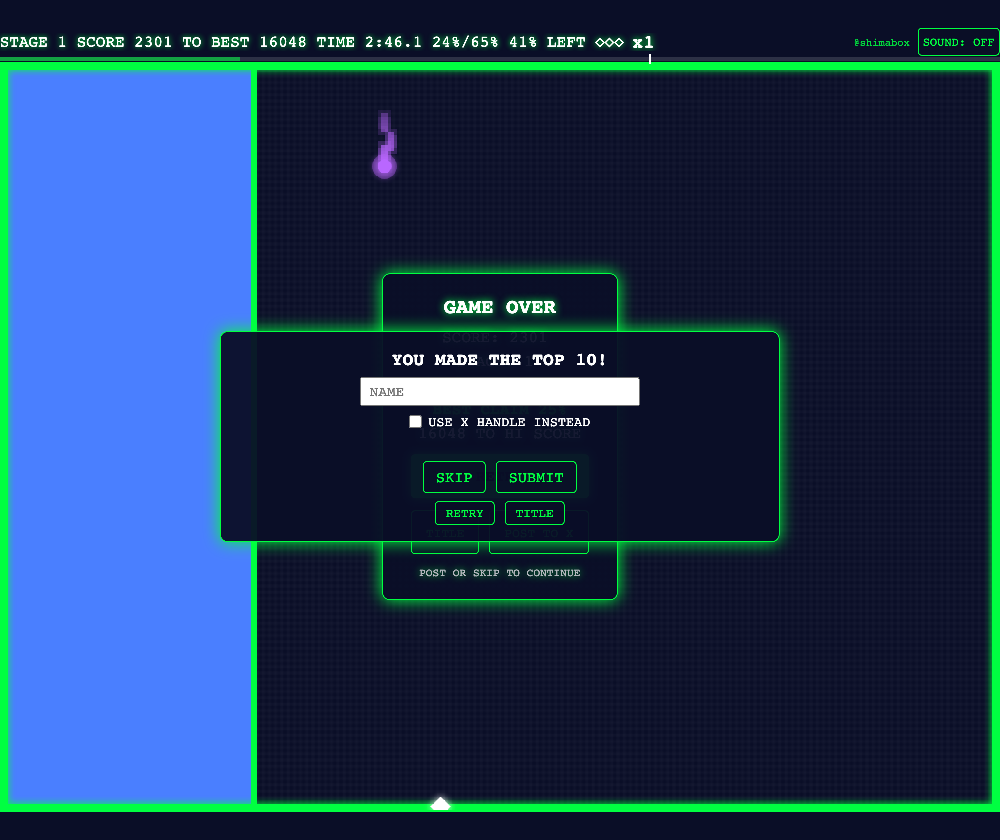

1. **NAME** 欄に名前（24 文字まで）を入力します
2. 名前の代わりに X ハンドルで投稿したいときは、**USE X HANDLE INSTEAD** にチェックを入れて `@handle` 欄に入力します（英数字と `_`、15 文字まで。先頭の `@` はあってもなくても構いません）
3. **SUBMIT** を押すと投稿されます。投稿しないときは **SKIP** を押します
4. フォームの下の **RETRY** / **TITLE** で、投稿せずにそのままもう一度遊ぶ、またはタイトルに戻ることもできます（送信中は押せません）

名前も X ハンドルも空のまま **SUBMIT** を押すと、`ENTER A NAME OR X HANDLE.` と表示されます。

投稿後の表示の意味は次のとおりです（日本語表示では、それぞれ日本語の文で表示されます）。

| 表示 | 意味 |
|---|---|
| `SUBMITTED.` | 投稿を受け付けた |
| `SUBMITTED — PENDING VERIFICATION.` | 投稿を受け付けた。スコアはあとから確認されることがある |
| `NOT CURRENTLY IN CONTENTION FOR THE TOP 10 — NOT SAVED.` | 送信時点で圏外になっていた。保存されない |
| `SUBMIT FAILED — YOU CAN TRY AGAIN.` | 通信などの失敗。再送できる |

`SUBMITTED.` と `SUBMITTED — PENDING VERIFICATION.` は、どちらも投稿を受け付けたことを表す表示です。一覧に出るかどうかは、ほかの投稿との順位で決まります。
スコアの確認を待っている投稿も、表示の対象になれば、ほかの行と区別なく一覧に並びます。

このほか、入力内容に問題があるときや、一時的に受け付けられないときは、その旨のメッセージが表示されます。**SUBMIT** ボタンが残っている場合は、内容を直すか時間をおいてから送り直せます。

### 10-4. リプレイを見る

一覧の **REPLAY** を押すと、そのプレイをステージ 1 から再生して見られます。記録の形式が今の版と合わないエントリは、一覧には載っても **REPLAY** ボタンが押せません。

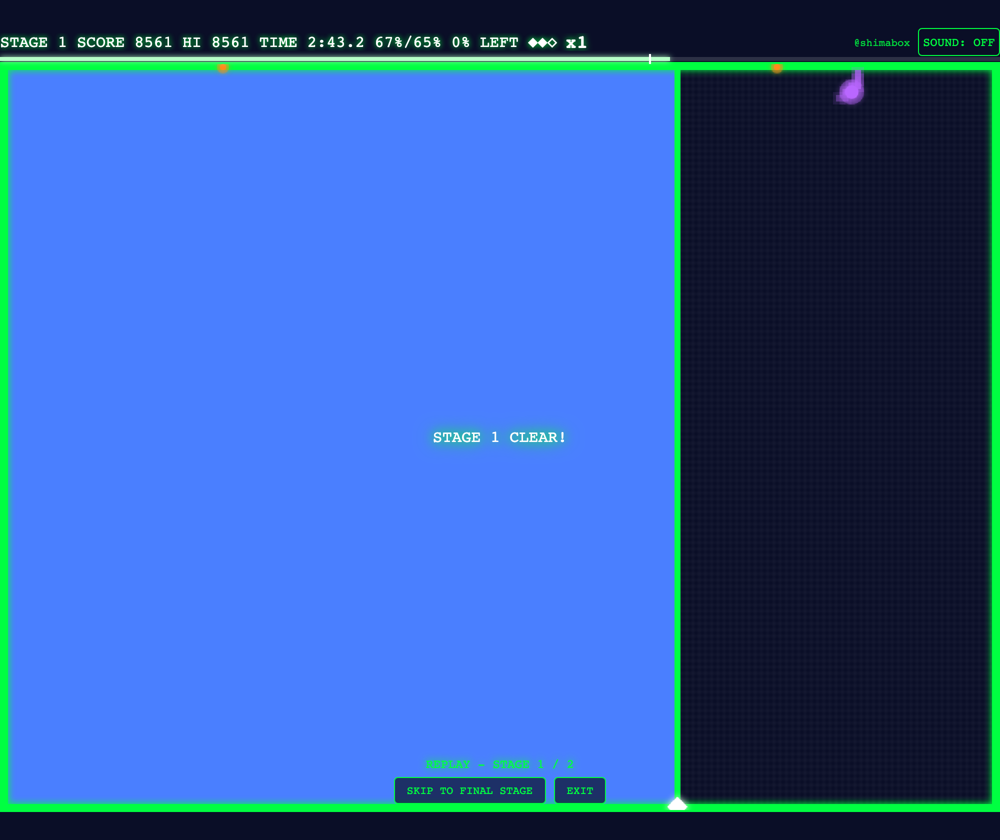

- 画面下に `REPLAY - STAGE n / N` と表示されます（n は再生中のステージ、N はそのプレイの最終ステージ）。最終ステージの再生中は末尾に `(FINAL STAGE)` が付きます
- ステージクリアの場面では `STAGE n CLEAR!` が約 1.5 秒表示され、自動で次のステージへ進みます
- **SKIP TO FINAL STAGE** で最終ステージまで飛ばせます
- 最後まで再生すると `GAME OVER - REPLAY END` とスコア・到達ステージが表示されます
- **EXIT** でランキング一覧に戻ります
- リプレイ中は効果音も BGM も鳴りません

### 10-5. 注意事項

- X ハンドルは自己申告で、本人確認はしていません
- 投稿されたスコアは後から確認されることがあり、不正と判断されたものは削除されることがあります
- ランキングは運営の判断でリセット（シーズン切替）されることがあります
- 短時間に多数のリクエストを送ると、一時的に受け付けられないことがあります

---

## 11. スコアまとめ

| 行動 | 得点 | クリア画面の行 |
|---|---|---|
| 高速ラインでエリア確定 | 面積（マス数）× **0.5 点** × 倍率 | `AREA` |
| 低速ラインでエリア確定 | 面積（マス数）× **1.0 点** × 倍率 | `AREA` |
| 1 回で盤面の 15% 以上を確定（**BIG CLAIM**） | その確定の面積の得点が **1.5 倍**（分断の確定も同じ）。盤面に `BIG CLAIM` と出ます | `AREA` |
| ウィスプの頭が、引いている途中のラインかマーカーに 3 マス以内まで近づいたラインを確定（**CLOSE CALL**） | 200 点 × 倍率（1 本のラインにつき 1 回）。盤面に `CLOSE CALL +n` と出ます | `AREA` |
| 占有率でステージクリアしたときの超過ボーナス | （達成占有率 − 目標占有率）のポイント差 × 100 点（倍率はかかりません） | `BONUS` |
| 分断成功 | 即クリア + 次のステージから倍率が、少ない側のウィスプの数だけ上がる（最低 +1、最大 x9） | — |

- 面積の得点は、確定ごとに「マス数 × 1 マスの点 × 倍率（BIG CLAIM ならさらに × 1.5）」を掛け終えてから、最後に 1 回だけ端数を切り捨てます。たとえば高速ライン・倍率 x1 の BIG CLAIM で 3,001 マスなら、`3001 × 0.5 × 1.5` = 2,250.75 → **2,250 点** です
- CLOSE CALL の距離は、縦と横の差の大きいほうで測ります。近づいたラインでも、引き戻して開始地点まで戻ったり、ミスしたりしたときは、ボーナスはつきません

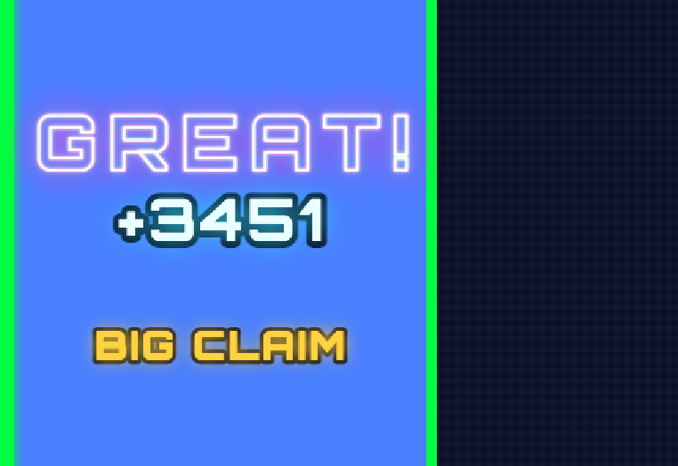

---

## 12. 上達のコツ

- **最初は端から小さく削る。** 欲張って真ん中に長い線を引くほど、ウィスプに触られる時間が長くなります
- **ウィスプの位置を見てから引く。** ウィスプがみな同じ側にいるときは、塗られるのは「ウィスプがいない側」（分断のときは 8 章）。ウィスプが端に寄った瞬間が大きく取るチャンス
- **立ち止まらない。** ライン引き中に方向の入力を止めるとイグナイターが出ます（5 章）。引き始めたら一気に
- **低速ラインは仕上げに。** 残りわずかで安全な場所を低速で取ると、スコアが効率よく伸びます
- **エンバーの気配を感じたら移動。** 枠の上も安全地帯ではありません。同じ場所に留まらないこと
